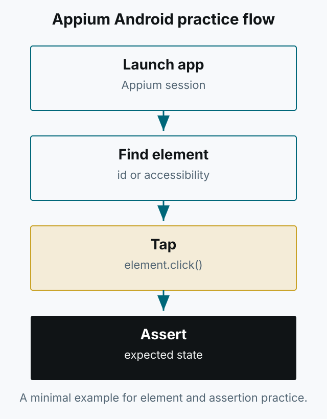

Appium으로 Android 자동화를 처음 시작할 때 필요한 최소한의 예제를 모아 둔 저장소입니다. 요소를 찾아 클릭하고, 기대한 상태인지 확인하는 흐름을 직접 실행해 볼 수 있습니다.

*그림 1. 예제 앱 실행, 요소 탐색, 클릭, Assertion으로 이어지는 연습 흐름.*

- 저장소: [PracticeAutomationAppiumAndroid](https://github.com/kimkitae/PracticeAutomationAppiumAndroid)

설치와 실행 방법은 저장소의 README를 참고하세요. 당시에는 Apple 개발자 등록이 없어 iOS용 샘플 IPA를 만들지 못했습니다. iOS 자동화에는 Appium의 XCUITest 드라이버를 사용하면 됩니다. 오래된 예제이므로 현재 Appium 버전과 Android SDK에 맞춰 일부 설정을 조정해야 할 수 있습니다.
