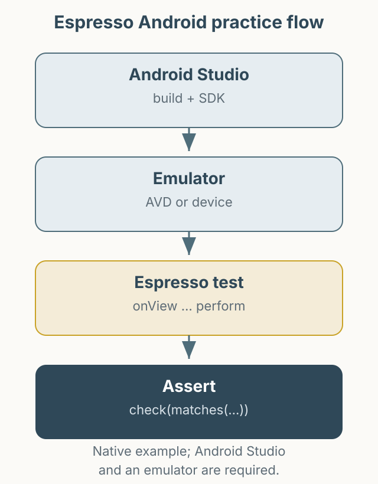

Espresso를 이용해 Android 자동화의 기초를 연습할 수 있도록 만든 예제 저장소입니다. 화면 요소를 찾아 클릭하고, 상태를 검증하는 가장 단순한 흐름을 다룹니다.

*그림 1. Android Studio에서 빌드한 뒤 Espresso 테스트로 화면 동작을 검증하는 흐름.*

- 저장소: [PracticeAutomationEspressoAndroid](https://github.com/kimkitae/PracticeAutomationEspressoAndroid)

Android Studio와 SDK Manager, 에뮬레이터가 준비된 상태를 가정합니다. 자세한 설치는 README를 참고하세요. Apple 개발자 등록이 없어 XCUITest용 샘플은 포함하지 않았습니다. 예제는 작성 당시 버전을 기준으로 하므로, 최신 Gradle과 Android SDK에서 빌드할 때는 의존성 버전을 확인해야 합니다.
