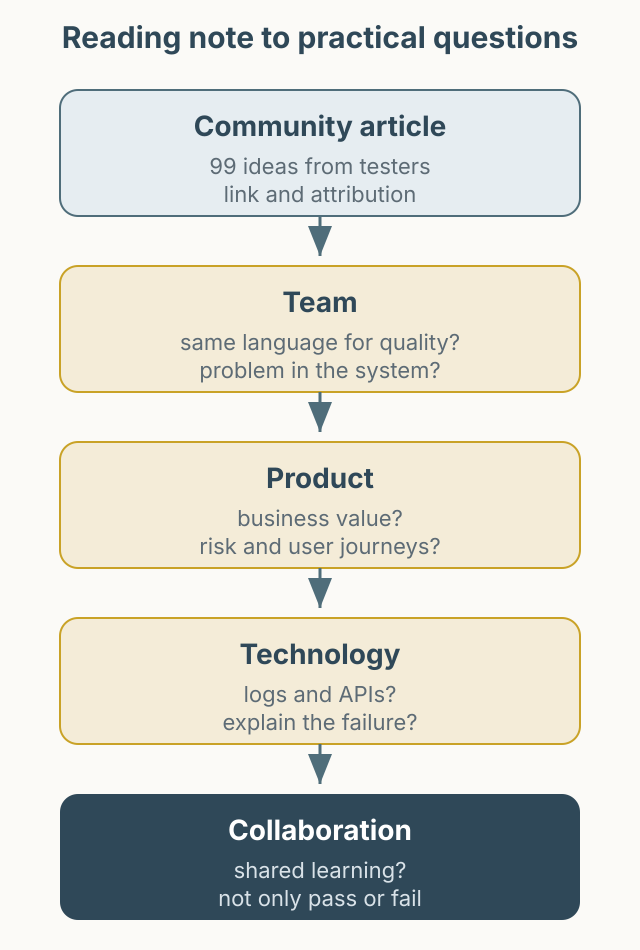

2018년 Ministry of Testing 커뮤니티에서 “더 나은 소프트웨어 테스터가 되기 위해 무엇을 할 수 있을까”라는 주제로 아이디어를 모았습니다. 이 글은 2021년에 그 글을 읽고 남긴 짧은 독서 노트입니다. 원문 스레드는 작성 당시에도 계속 업데이트되고 있었습니다.

- 원문: [Community Thoughts: 99 Things You Can Do To Become A Better Software Tester v2.0](https://club.ministryoftesting.com/t/99-things-you-can-do-to-become-a-better-software-tester/17923)

*그림 1. 원문을 그대로 옮기지 않고, 팀 맥락에 맞는 질문으로 바꾸는 방식.*

## 원문을 읽는 방식

이 글은 원문의 번역이나 전문 재게시가 아닙니다. 원문에는 다양한 테스터가 각자의 경험을 짧게 남겼고, 그 경험을 제 것으로 옮겨 적으면 맥락이 사라집니다. 그래서 아이디어를 그대로 요약하기보다, “우리 팀에 적용하려면 무엇을 확인해야 하는가”라는 질문으로 바꿔 읽었습니다.

## 읽으며 바꿔 본 질문

- **팀**: 우리 팀이 품질을 이야기할 때, 개발자와 기획자가 같은 언어를 쓰고 있는가? 의견이 다를 때 문제를 사람이 아니라 시스템에 두고 이야기하는가?
- **제품**: 이 기능이 비즈니스에서 어떤 가치를 만드는지 설명할 수 있는가? 테스트 범위가 화면 목록이 아니라 사용자 흐름과 위험에 연결되어 있는가?
- **기술**: 로그와 API로 상태를 확인할 수 있는가? 자동화가 실패했을 때 원인을 설명할 수 있는가?
- **협업**: 테스트 결과를 “통과/실패”가 아니라 “무엇을 배웠는가”로 공유하고 있는가?

원문에는 “개발자를 적으로 만들지 말라”, “비즈니스를 배우라”, “테스트는 사회적 활동이다” 같은 조언이 나옵니다. 문장은 짧지만, 실제로 지키려면 꽤 많은 대화와 관찰이 필요합니다.

## 읽고 남은 생각

좋은 테스터가 되기 위한 방법은 거창한 도구보다 기본적인 습관에 가까웠습니다. 질문을 잘하고, 근거를 남기고, 실패를 숨기지 않는 것. 이 노트가 원문의 모든 아이디어를 대신하지는 않습니다. 관심이 있다면 원문 링크에서 직접 읽고, 자신의 팀 상황에 맞는 질문을 골라 보시길 권합니다.
