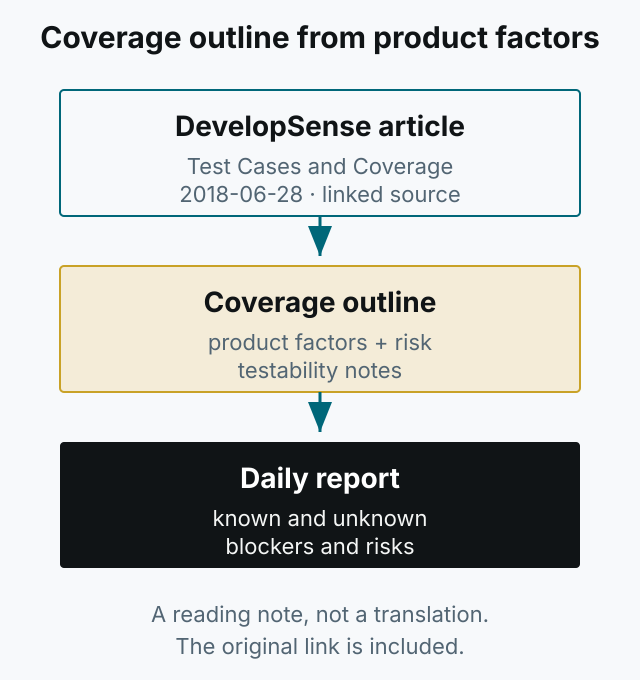

이 글은 Michael Bolton이 DevelopSense에 쓴 “Test Cases and Coverage”(2018-06-28)를 읽고 남긴 짧은 메모입니다. 원문: [Test Cases and Coverage](https://developsense.com/blog/2018/06/test-cases-and-coverage)

*그림 1. 테스트 케이스 목록보다 제품 요인과 위험에서 출발하는 커버리지 개요.*

원문은 테스트 케이스 문서와 테스트 활동을 구분하고, 제품 요인과 위험에서 출발하는 커버리지 개요를 강조합니다. 일일 보고에는 통과/실패 개수보다 테스트 용이성과 제품 가치를 위협하는 위험을 담으라고 말합니다.

아이디어와 맥락은 원문에서 직접 확인하세요. 이 노트는 원문의 요약이나 번역을 대신하지 않습니다.
