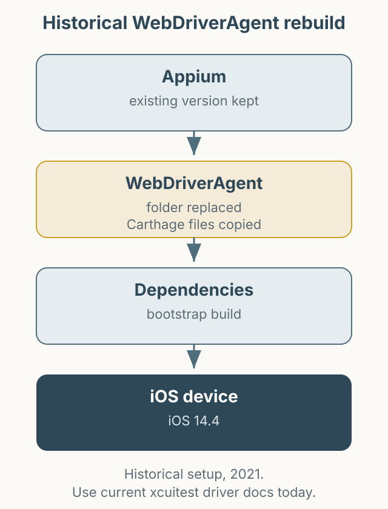

이 글은 2021년 iOS 14.4 환경에서 Appium 전체를 올리지 않고 WebDriverAgent만 교체해야 했던 경험을 남긴 기록입니다. 현재의 Appium과 XCUITest 드라이버 구조와는 차이가 있으므로, 지금 같은 문제를 겪는다면 이 글의 명령을 그대로 따르기보다 [`appium-xcuitest-driver` 공식 문서](https://appium.github.io/appium-xcuitest-driver/)를 먼저 확인하세요.

*그림 1. 당시 WebDriverAgent를 교체하고 Carthage 의존성을 다시 받아 빌드하던 흐름.*

## 당시 상황

iOS 14.4로 업데이트한 뒤 기존 WebDriverAgent가 동작하지 않았습니다. 자동화 프로젝트 때문에 Appium 버전은 유지해야 했고, WebDriverAgent만 최신 버전으로 바꿔야 했습니다. 빌드 중에는 Carthage 래퍼가 실패하는 오류가 발생했습니다.

당시에는 `appium/WebDriverAgent` 저장소의 파일을 받아 기존 `appium-webdriveragent` 폴더를 교체하는 방식으로 해결했습니다. 새 폴더에는 Carthage 관련 파일이 없었기 때문에, 기존 폴더의 `Carthage`, `Scripts/carthage.sh`, `Cartfile`, `Cartfile.resolved`를 보관했다가 같은 위치에 다시 넣었습니다. 이후 `carthage-wrapper.sh bootstrap`을 실행해 의존성을 받았습니다.

## 지금 다시 한다면

지금은 Appium의 XCUITest 드라이버가 WebDriverAgent 빌드를 관리하므로, 폴더를 직접 교체하는 방식은 권장되지 않습니다. 다음 순서로 확인하는 편이 안전합니다.

1. Appium과 `appium-xcuitest-driver` 버전을 공식 문서에서 확인합니다.
2. 단말의 iOS 버전과 Xcode 버전 호환성을 확인합니다.
3. `appium driver doctor xcuitest` 등 진단 도구로 환경을 점검합니다.
4. 그래도 해결되지 않으면 드라이버 로그와 WebDriverAgent 빌드 로그를 함께 첨부해 이슈를 확인합니다.

## 정리

이 글은 당시의 문제 해결 과정을 보존하기 위한 기록입니다. 특정 버전의 명령을 현재 환경에 그대로 적용하면 오히려 문제가 커질 수 있습니다. 오래된 자동화 글을 읽을 때는 “그때는 이렇게 했다”와 “지금도 이렇게 해야 한다”를 구분하는 것이 중요합니다.
