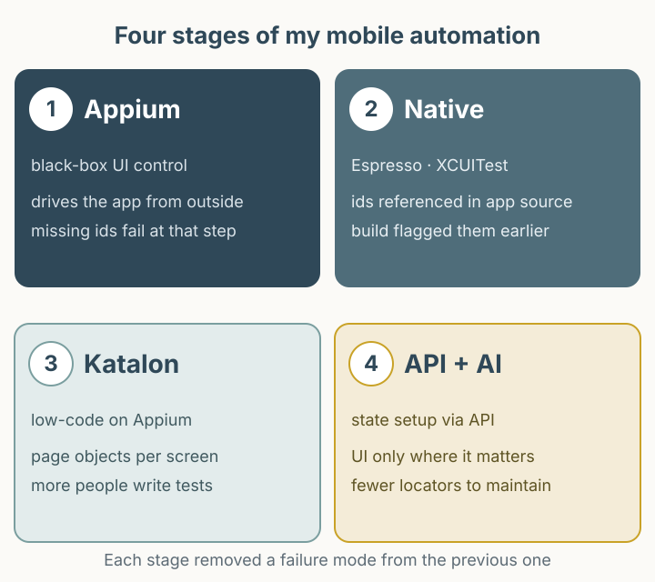

모바일 자동화가 실패하면 도구를 바꾸기 전에 실패의 종류부터 구분해야 합니다. 앱이 깨졌는지, 단말이 준비되지 않았는지, 이전 실행의 데이터가 남았는지에 따라 고칠 곳이 달라집니다. 2024년에 공개한 Appium·네이티브 프레임워크·Katalon 전환 기록을 바탕으로, 지금 같은 테스트를 설계한다면 어떤 기준을 쓸지 정리했습니다. 아래 진단표와 주문 예시는 그때의 운영 결과가 아니라 이번에 제안하는 방법입니다.

*그림 1. 상태 준비와 UI 검증을 나눈 설계 예시. 단계별 증거를 남기면 실패 지점을 좁힐 수 있습니다.*

## 도구를 바꾼 네 번의 판단

2014년에 Appium을 처음 접했습니다. GUI 기반 도구와 달리 코드와 CLI로 동작한다는 점이 인상적이었고, 국내 참고 자료가 거의 없어 Android 단말 한 대를 안정적으로 제어하는 데도 오랜 시간이 걸렸습니다. 이후 여러 단말을 병렬로 돌리고 결과를 수집해 릴리스 프로세스에 연결했습니다.

2018년 커머스 QA에서는 Appium으로 Android와 iOS를 함께 다뤘고 Jenkins로 빌드와 테스트를 연결했습니다. 그러다 리소스 ID 누락·변경으로 인한 실패가 반복됐습니다. 이때 Espresso(Android)와 XCUITest(iOS)로 옮겼고, 이후에는 Katalon과 페이지 오브젝트로 작성자 층을 넓혔습니다. 2024년 원문을 쓸 무렵에는 API로 상태를 준비하고 UI는 확인 지점에만 쓰는 방식, 그리고 GPT로 셀렉터를 고치는 실험을 적었습니다.

네 번의 선택은 모두 같은 질문에서 나왔습니다. **이 실패를 누가, 언제, 어떤 증거로 설명할 수 있는가.**

## 무엇을 어디서 검증할 것인가

도구를 고르기 전에 검증 대상을 나누면 선택이 단순해집니다.

| 검증 대상 | UI에서 | API에서 | 이유 |
|---|---|---|---|
| 화면에 값이 실제로 보이는가 | 1차 검증 | 불가 | 렌더링·포맷·접근성은 UI에만 있다. |
| 계산·권한·상태 전이가 맞는가 | 느리고 불안정 | 1차 검증 권장 | 서버가 최종 판단을 갖고 있고, 실패 지점이 좁다. |
| 사용자가 하는 한 번의 동작이 되는가 | 1차 검증 | 불가 | 탭·입력·스크롤 자체가 검증 대상일 때가 있다. |
| 다음 테스트의 시작 상태 | 피한다 | 권장 | UI로 데이터를 만들면 실패 원인이 UI와 데이터에 섞인다. |

예를 들어 한 시나리오를 “상태 준비 호출 1회 + UI 확인 1회”로 나누는 식입니다. 이는 제안한 배분 예시이며, 측정된 절감 수치가 아닙니다. 원문에서 API 기반 접근이 리소스 ID 의존성을 낮췄다고 적은 것도 같은 이유입니다. 다만 API로 상태를 만들면 UI를 통과하지 않은 데이터가 생길 수 있으므로, 사용자가 실제로 그 상태에 도달하는 경로는 별도 시나리오로 남겨야 합니다. 서버가 없는 오프라인·클라이언트 전용 앱이라면 이 표의 API 열은 비어 있을 수 있습니다. 이 표는 책임을 나누는 기준이지 모든 앱에 같은 계층이 있다는 뜻이 아닙니다.

프레임워크 선택도 같은 축에서 봅니다. Appium은 앱 외부에서 접근성 트리를 읽는 블랙박스 방식이라 작성자가 앱 소스를 몰라도 되고 언어 선택이 자유롭습니다. 대신 셀렉터가 런타임 문자열이고, 화면 계층이 앱 구현에 따라 달라집니다. Espresso는 앱 프로세스 안에서 실행되고, XCUITest는 별도 테스트 러너에서 접근성 계층을 통해 앱을 제어합니다. 둘 다 앱 빌드와 테스트 타깃을 함께 관리해야 하므로 빌드 파이프라인과 결합되고, 접근 권한이 있는 사람만 작성할 수 있습니다. 이 결합이 항상 이득은 아닙니다. 소스 접근·빌드 통합과 셀렉터 검증 시점은 별개 축입니다. 같은 모듈에 테스트 타깃을 두면 빌드에 통합되지만, 셀렉터를 리소스 참조로 쓰는지 문자열로 쓰는지에 따라 컴파일 시점 검증 여부가 달라집니다.

## 네이티브가 항상 컴파일 타임 검증은 아니다

원문은 네이티브 프레임워크로 옮긴 뒤 “테스트 수행 없이 빌드 단계에서 리소스 ID 변경을 확인할 수 있었다”고 적었습니다. 이 경험은 사실이지만, 플랫폼에 따라 이유가 다릅니다.

Android에서 `R.id.checkout_button`은 빌드 시 생성되는 정수 상수입니다. 테스트가 이 상수를 참조하면 ID가 사라졌을 때 테스트 코드가 컴파일되지 않습니다. 반면 iOS의 XCUITest는 `app.buttons["checkoutButton"]`처럼 접근성 식별자를 **런타임 문자열로 조회**합니다. 앱에서 식별자를 지워도 테스트는 컴파일되고, 실행 중에 요소를 찾지 못해 실패합니다. “네이티브라서 컴파일 타임에 잡힌다”는 설명은 Android의 리소스 참조에는 맞고, iOS의 접근성 문자열에는 맞지 않습니다.

빌드가 실제로 무엇을 잡는지는 설정에도 달려 있습니다. 테스트 타깃이 같은 모듈에 있고 리소스 참조를 쓰는지, 문자열 셀렉터를 쓰는지, lint 규칙이 켜져 있는지에 따라 결과가 달라집니다. 그래서 “네이티브로 바꾸면 셀렉터 문제가 사라진다”가 아니라 “참조 방식에 따라 잡히는 시점이 달라진다”가 정확한 표현입니다.

Appium 쪽도 정정할 점이 있습니다. Appium은 요소를 찾는 그 단계에서 실패하며, 스위트 전체가 끝나야 실패를 알려 주는 도구가 아닙니다. 원문은 피드백이 늦었다고만 적고 그 원인을 확정하지 않습니다. 여러 단말의 결과를 모아 스위트 종료 후 리포트하는 방식이라면 첫 실패 확인이 늦어질 수 있지만, 이는 가능한 파이프라인 문제이지 확인된 과거 원인이 아닙니다. 이 구분을 놓치면 도구를 바꿔도 같은 지연이 남을 수 있습니다.

배포 주기가 2주에서 1주로 줄어든 데에는 이 전환이 기여했습니다. 다만 배포 주기는 팀 구성, 릴리스 정책, 빌드 시간의 영향을 함께 받으므로, 프레임워크 교체만으로 단축됐다고 단정할 수는 없습니다.

## 작업 예시: 상태 준비, 한 번의 UI 상호작용, 증거

아래 표는 실행 코드가 아니라 같은 검증을 입력·기대·관찰·증거·정리로 나눈 예시입니다. 사내 엔드포인트나 실제 할인 규칙이 아니며, 실행환경도 검증하지 않았습니다. 핵심은 역할 분리입니다.

| 단계 | 입력과 동작 | 기대 | 증거 | 실패 시 |
|---|---|---|---|---|
| 1. 상태 준비 | 쿠폰 미적용 주문 생성(상품 1개, 10,000원) | `order_id`, 생성 응답의 `payable_total` 10,000원 | 요청·응답 JSON, `order_id` | 주문 생성 실패는 UI가 아니라 환경 문제로 분류한다. |
| 2. UI 동작 | 장바구니를 열고 10% 쿠폰 적용 버튼을 한 번 누른다 | 화면 총액 9,000원 | 클릭 전후 스크린샷 | 탭 실패는 로케이터 또는 화면 상태 문제다. 상태 준비는 이미 끝났다. |
| 3. 검증 | 화면 총액과 API 재조회 총액을 비교한다 | 둘 다 9,000원 | 스크린샷, API 재조회 응답 | 9,000원이 아니면 계산 또는 표시 문제다. |
| 4. 정리 | 성공·실패와 무관하게 주문을 삭제한다 | 삭제 응답 확인, 주문 조회 불가 | `order_id`, 삭제 시각, 삭제 실패 로그 | 정리 실패도 다음 실행의 데이터 오염 원인이므로 로그에 남긴다. |

기대 총액은 쿠폰 적용 전 금액(10,000원)이 아니라 쿠폰 규칙으로 계산한 9,000원입니다. 적용 전 응답을 기대값으로 쓰고 적용 후 화면과 비교하면 항상 불일치합니다. 정리 단계는 성공·실패와 상관없이 실행되도록 `try/finally` 같은 보장된 경로에 두십시오.

증거는 실패했을 때만 모으지 않습니다. 통과한 실행에서도 주문 ID와 기대값을 남겨야, 다음 실행에서 데이터가 남아 실패할 때 비교할 수 있습니다. 스크린샷만 남기면 “무엇이 기대값이었는지”가 사라집니다.

## 실패를 네 종류로 나누는 진단표

실패 메시지를 읽는 순서를 정해 두면 원인 추적이 빨라집니다. 아래 표는 지금의 진단 순서입니다.

| 분류 | 전형적인 증상 | 먼저 볼 증거 | 다음 조치 |
|---|---|---|---|
| 환경·인프라 | 여러 테스트가 같은 지점에서 실패, 세션 생성 실패 | `adb devices`, 드라이버·OS 버전, 세션 캐퍼빌리티, 실행 노드 로그 | 앱 실패로 기록하지 않고 환경부터 고친다. |
| 로케이터·렌더링 | 특정 화면에서만 요소 없음, 계층이 비어 있음 | page source·접근성 스냅샷, 스크린샷, 로딩/애니메이션 상태 | 대기 조건과 식별자를 확인한다. |
| 데이터 상태 | 요소는 있는데 값이 이전 실행과 같음 | 요청 페이로드, 조회 API 응답, 계정 잔여 상태 | 상태 준비를 고립하고 정리 단계를 넣는다. |
| 업무 규칙 | UI는 정상인데 결과 값이 다름 | 서버 로그, 계산 근거, 스펙 | 제품 결함으로 분류하고 재현 절차를 남긴다. |

이 표의 효용은 “재시도하면 통과하는 테스트”를 줄이는 데 있습니다. 재시도로 넘어간 실패가 환경 문제인지 데이터 오염인지 모르면, 같은 원인이 계속 쌓입니다. 재시도 횟수와 함께 실패 분류를 로그에 남기면 원인이 드러납니다.

## 자동 셀렉터 복구가 통과를 만들어 내는 방식

2024년 원문에는 GPT로 페이지 소스를 비교해 셀렉터를 고치는 실험을 긍정적으로 적었습니다. 지금의 판단은 다릅니다. 자동 복구는 실패 원인 후보를 제안하는 데는 쓸 수 있지만, 결과를 그대로 통과로 처리하면 **실패한 테스트가 다른 이유로 통과**할 수 있습니다.

예를 들어 화면에 “확인” 버튼이 두 개 있고, 원래 대상은 결제 확인 버튼이었다고 합시다. 셀렉터가 깨진 뒤 자동 복구가 먼저 일치하는 “확인” 버튼을 고르면, 테스트는 클릭에 성공하고 다음 단계도 진행됩니다. 최종 검증이 “예외가 없었다” 수준이면 결과는 통과입니다. 사용자는 결제를 하지 않았는데 테스트는 성공한 것입니다.

막는 방법은 세 가지입니다.

1. **모호하면 실패시킨다.** 후보가 둘 이상이면 자동 선택하지 않고 실패로 남깁니다.
2. **변경을 기록한다.** 기존 셀렉터, 새 셀렉터, 근거를 로그와 리포트에 남겨 사람이 검토할 수 있게 합니다.
3. **업무 결과를 검증한다.** 요소 존재가 아니라 결제 완료 상태처럼 업무 결과를 확인해야 합니다.

자동 복구의 정확도나 통과율은 이 글에서 측정하지 않았습니다. 특정 환경의 수치 없이 “효과가 크다”고 말할 수 있는 근거는 없습니다. 이미지 비전도 같은 위치에 둡니다. 화면을 읽지 못할 때의 보조 신호이지, 검증의 기준이 될 수 없습니다.

## 지금의 판단

도구를 바꾸기 전에 확인할 것은 세 가지입니다. 상태 준비를 API로 분리할 수 있는가, 실패를 원인별로 분류해 로그에 남기고 있는가, UI에서 반드시 봐야 하는 지점을 한두 개로 좁혔는가. 이 세 가지가 되면 Appium이든 네이티브 프레임워크든 같은 실패를 더 빨리 설명할 수 있습니다.

원문의 2024년 판단과 지금의 판단이 다른 부분은 자동 복구에 대한 신뢰도입니다. 그 차이는 이 글이 정리하면서 생긴 것이며, 당시 운영에서 자동 복구 때문에 잘못된 통과가 실제로 발생했다는 기록은 없습니다.
