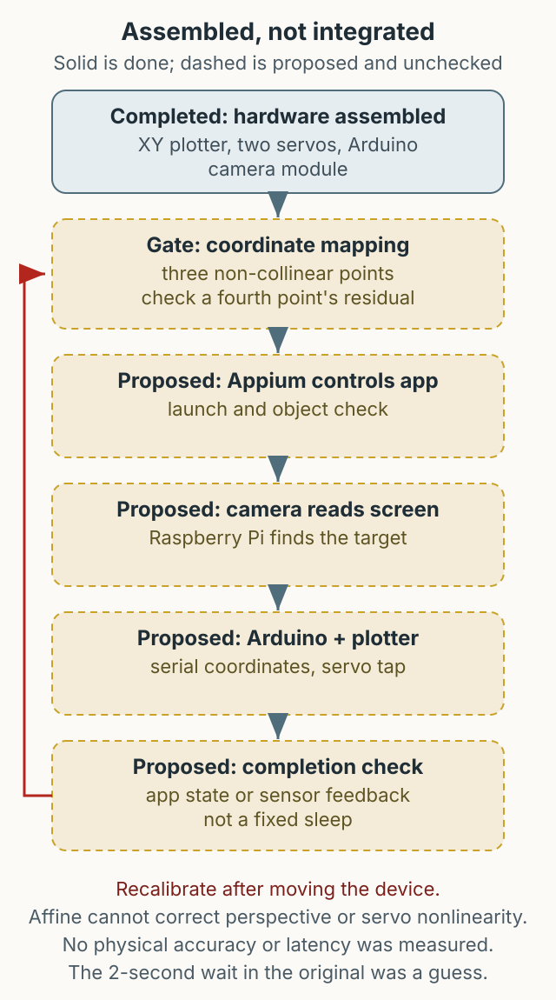

결제 수단이 여러 개인 서비스를 테스트하면 배포마다 주문부터 결제 완료까지 모든 결제 수단을 확인해야 합니다. 각 PG사 화면의 가상 키보드는 암호화되어 있고 숫자 배열이 매번 바뀌며, 캡처 보호가 걸린 영역은 검은색으로 보입니다. 이 글은 그 반복을 줄이려고 소프트웨어 밖으로 나가 본 실험의 중간 기록입니다. 결론부터 말하면 하드웨어는 조립했지만 소프트웨어 연결은 마무리하지 못했습니다.



*그림 1. 당시 구상한 동작 흐름입니다. 하드웨어 조립까지 진행했고, 소프트웨어 연결은 끝내지 못했습니다.*

## 왜 하드웨어였나

테스트 프레임워크가 CPU와 메모리를 많이 쓰는 문제도 있었습니다. 이 부하를 나누기 위해 일부 작업을 별도 하드웨어에 맡기고 API로 통신하는 발상을 했습니다.

모바일 자동화는 보통 접근성 트리나 화면 캡처로 요소를 찾습니다. 그런데 결제 화면처럼 보안이 강한 화면은 캡처 결과가 비어 있거나 가상 키패드 배열이 매번 바뀔 수 있습니다. 그래서 화면을 읽는 대신 사람이 누르는 동작을 물리적으로 흉내 내는 쪽으로 발상을 바꿨습니다.

## 구상한 동작 흐름

알리익스프레스에서 아두이노로 커스터마이징할 수 있는 XY 플로터 기성품을 구매하고, 아두이노 또는 라즈베리파이에 카메라 모듈을 연결하는 구성이었습니다. 만들고 싶었던 흐름은 다음과 같습니다.

1. Appium으로 앱을 실행하고 오브젝트가 있는지 확인합니다.
2. 라즈베리파이 카메라로 화면을 캡처하고 오브젝트를 식별합니다.
3. 식별한 좌표를 시리얼로 아두이노 로봇팔에 전달합니다.
4. 서보가 X·Y 축을 움직여 목표 지점을 누릅니다.
5. Appium으로 클릭 결과를 다시 확인합니다.

이 흐름은 설계와 코드 조각으로 남아 있지만, 전체가 실제 단말에서 끝까지 동작하는 것은 확인되지 않았습니다.

```python
# 원문 예시의 좌표 전달부
from flask import Flask, request, jsonify

app = Flask(__name__)

@app.post("/click")
def click():
    data = request.get_json(force=True)
    x, y = int(data["x"]), int(data["y"])
    # ser.write(f"{x},{y}\n".encode())
    return jsonify({"status": "accepted", "x": x, "y": y})
```

원문 예시는 이 서버를 `0.0.0.0`에 열고 별도 인증을 두지 않았습니다. 지금 공개한다면 내부 주소에만 바인딩하고, 호출 주체를 확인하는 인증과 요청 제한을 먼저 붙여야 합니다.

## 아두이노와 서보 제어

아두이노는 시리얼로 좌표를 받아 서보를 움직입니다. 원문 코드는 서보 두 개를 X·Y 축에 연결하고, 좌표를 받은 뒤 클릭 동작을 수행한 다음 기준 위치로 돌아갑니다.

```cpp
#include <Servo.h>
Servo servoX;
Servo servoY;

void setup() {
  Serial.begin(9600);
  servoX.attach(9);
  servoY.attach(10);
}
```

서보 각도와 화면 좌표는 일대일로 대응하지 않습니다. 지금 다시 만든다면 기기 크기와 화면 위치마다 기준점을 잡는 캘리브레이션 절차를 먼저 설계하고, 단말을 옮겼을 때 다시 맞춰야 한다는 전제로 운영 비용을 계산하겠습니다. 기구의 유격, 화면과의 거리, 조명, 카메라 해상도도 함께 맞춰야 하는 물리 변수입니다.

## 마무리 상태

당시 마무리한 것은 하드웨어 조립까지였습니다. 시간이 되면 소프트웨어 연결을 끝내고, 단말 크기에 맞는 XY 플로터를 한 대씩 연결해 BDD 형태의 시나리오를 계속 실행하고 싶었습니다. 여기까지는 목표였으며, 이 글에서 완성된 운영 사례로 소개하는 것은 아닙니다.

지금 다시 만든다면 다음을 먼저 정하겠습니다.

- 좌표 API는 내부 인터페이스에만 바인딩하고 인증을 붙입니다.
- 로봇팔의 고정 대기 시간 대신 완료 신호나 센서 피드백으로 다음 동작을 시작합니다.
- 단말마다 플로터를 두는 방식의 공간·관리 비용과 재캘리브레이션 비용을 먼저 계산합니다.
- 보안 화면을 우회하는 대신, 허용된 테스트 환경에서만 물리 동작을 재현합니다.

이 글의 코드는 당시 실험을 설명하기 위한 조각이며, 그대로 운영 환경에 적용하기 위한 완성 코드가 아닙니다.
