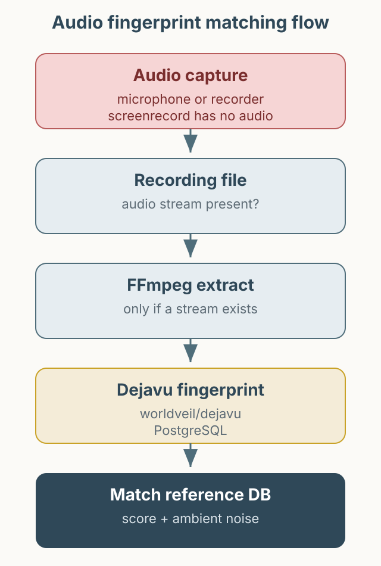

알림음이 정상적으로 재생됐는지는 눈으로 확인하기 어렵습니다. 화면에는 표시가 남지 않고, 소리는 테스트가 끝난 뒤 사라지기 때문입니다. 이 글은 오디오 지문(fingerprint)으로 알림음을 식별해 자동 검증에 사용한 경험을 정리합니다. 먼저 바로잡을 점이 있습니다. 예전 글에서 Docker Hub의 `appbaseio/dejavu`를 오디오 지문 도구로 소개했는데, 그것은 Elasticsearch 데이터 뷰어입니다. 오디오 지문에는 [`worldveil/dejavu`](https://github.com/worldveil/dejavu)를 사용해야 합니다.



*그림 1. 소리를 함께 기록한 파일에서 오디오를 추출해 지문을 만들고, 미리 저장한 알림음과 비교하는 과정.*

## 오디오 지문이란

오디오 지문은 소리의 파형을 그대로 비교하지 않습니다. 주파수와 시간축에서 특징적인 피크를 뽑아 해시로 바꾸고, 그 해시를 데이터베이스에 저장합니다. 이후 짧은 녹음에서 같은 해시가 얼마나 겹치는지를 세어 원본과 매칭합니다. 압축이나 주변 소음이 섞여도 어느 정도 견디는 이유입니다.

`worldveil/dejavu`는 이 과정을 Python으로 제공합니다. 기준 음원을 디렉터리 단위로 지문화하고, 마이크나 파일 입력으로 인식할 수 있습니다. 설치와 실행 방법은 저장소의 현재 문서를 기준으로 확인하는 것이 안전합니다. 원문 환경은 docker-compose로 PostgreSQL을 함께 실행하고 `songs`, `fingerprints` 테이블을 사용했습니다.

```python
from dejavu import Dejavu

config = {
    "database": {"host": "127.0.0.1", "user": "dejavu", "password": "change-me", "database": "dejavu"},
    "database_type": "postgres",
}
djv = Dejavu(config)
djv.fingerprint_directory("reference_sounds/", [".mp3", ".wav"])
```

위 코드는 구조를 설명하기 위한 축약 예시입니다. 실제 설정 키와 지원 데이터베이스는 라이브러리 버전에 따라 다를 수 있으므로, 실행 전에 공식 README를 확인해야 합니다.

## 소리를 먼저 녹음해야 한다

검증 흐름에서 가장 먼저 확인할 것은 “녹음 파일에 소리가 들어 있는가”입니다. Android의 `adb shell screenrecord`는 영상만 기록하며 오디오를 포함하지 않습니다. Appium의 Android 화면 녹화도 같은 제약을 갖습니다. 따라서 알림음을 검증하려면 마이크 입력이나 오디오가 활성화된 별도 녹음기를 함께 사용해야 합니다. 원문에는 당시 어떤 녹음 경로를 사용했는지 명시되어 있지 않습니다.

검증 흐름은 다음과 같습니다.

1. Appium으로 알림이 발생하는 시나리오를 실행합니다.
2. 마이크 또는 오디오가 포함된 녹음기로 알림음 구간을 기록합니다.
3. 녹음 파일을 가져옵니다. 단말 파일이면 `adb pull`을 사용할 수 있습니다.
4. 파일에 오디오 스트림이 있으면 추출합니다.
5. 추출한 파일을 `worldveil/dejavu`로 인식해 기준 알림음과 매칭되는지 확인합니다.

```bash
# 오디오 스트림이 있는 파일에만 적용
ffmpeg -i notification.mp4 -vn -acodec pcm_s16le notification.wav
```

MoviePy를 쓴다면 2.x에서는 `from moviepy import VideoFileClip`을 사용합니다. 1.x의 `moviepy.editor` 경로는 2.x에서 제거되었으므로, [MoviePy 업데이트 안내](https://zulko.github.io/moviepy/getting_started/updating_to_v2.html)를 확인하세요. 이 글의 기본 예시는 FFmpeg입니다.

오디오를 함께 녹음한 파일에는 주변 소음과 다른 시스템음도 들어갑니다. 그래서 기준 음원을 여러 환경에서 미리 지문화해 두고, 매칭 점수가 일정 수준 이상인지를 보는 방식이 현실적입니다. 점수 임계값은 기기와 녹음 환경에 따라 달라지므로 고정값을 권하지 않습니다.

## 당시 관찰과 한계

집에서 TV가 켜져 있고 가족이 대화하는 환경에서도 알림음이 매칭된 적이 있습니다. 다만 이것은 특정 환경에서의 관찰이지, 모든 소음 조건에서 보장되는 성능 수치는 아닙니다. 녹음 경로, 마이크 위치, 볼륨, 운영체제의 오디오 처리에 따라 결과가 달라질 수 있습니다.

또한 이 방식은 “알림음이 났다”는 사실은 알려 주지만, “알림이 사용자에게 올바르게 전달됐다”는 것까지 보장하지 않습니다. 소리 매칭은 UI 검증과 함께 사용해야 의미가 있습니다. 운영에 넣는다면 기준 음원 관리, 임계값 모니터링, 실패 시 원본 녹음을 보관하는 정책이 필요합니다.

## 정리

오디오 지문은 눈으로 확인하기 어려운 알림음 검증에 유용한 보조 수단입니다. 다만 화면 녹화만으로는 소리를 얻을 수 없다는 전제를 먼저 확인해야 하고, 오디오가 없는 파일에는 추출 단계를 적용할 수 없습니다. 도구를 고를 때는 이름이 비슷한 다른 프로젝트와 혼동하지 않는 것도 중요합니다. 도입 전에는 공식 저장소의 예제로 짧은 파일 하나부터 검증해 보시길 권합니다.
