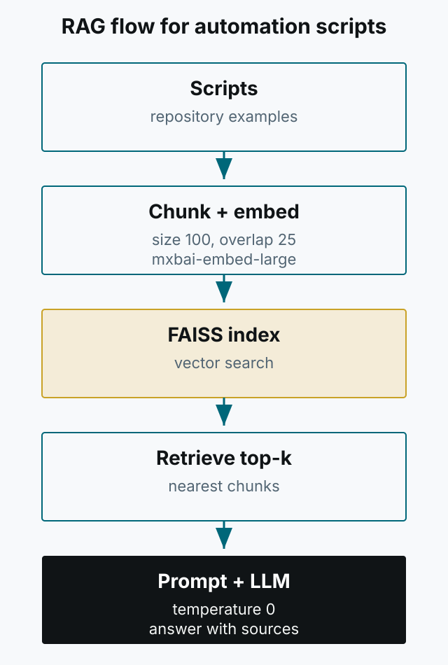
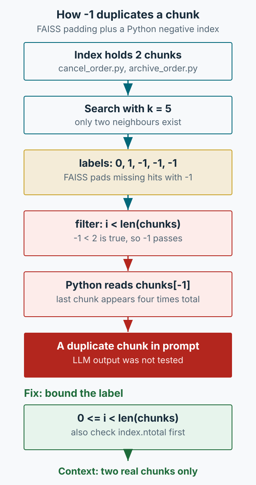

2024년에 작성한 RAG 검색 예제를 합성 벡터 두 개로 다시 실행했습니다. 인덱스에는 청크가 두 개뿐인데 결과는 다섯 개로 매핑됐고, 마지막 문서가 네 번 등장했습니다. 빈 검색 자리를 나타내는 `-1`을 Python의 목록 인덱스로 받아들인 탓입니다.

이것은 2026년에 이 글을 정리하며 실행한 재현 실험입니다. 당시 운영에서 이 문제가 발생했다는 기록은 없습니다. 다만 모델에 넘길 근거가 잘못 만들어지는 경로를 확인할 수 있습니다. 검색 결과를 보지 않고 프롬프트만 고치면 이 경로는 그대로 남습니다.



*그림 1. 인덱싱과 질의는 별개 경로입니다. 장애도 이 두 경로와 프롬프트 구성에서 따로 발생합니다.*

## 2024년의 제약과 선택

당시 환경은 데이터 외부 유출을 피해야 했기 때문에 로컬 실행을 선택했습니다. 모델은 Llama 3, 임베딩은 `mxbai-embed-large`, 벡터 인덱스는 `faiss-cpu`의 HNSW를 사용했습니다. 팀원은 별도 WebUI 대신 Slackbot으로 질문했고, 답변과 함께 LLM이 참고한 검색 결과를 노출했습니다.

파인튜닝도 검토했습니다. 원문에는 `Mlx-lm`으로 LoRA 학습을 시도했을 때 메모리 사용이 130GB였다고 적혀 있습니다. 이 값은 특정 하드웨어와 설정에서 관찰한 수치이지 RAG의 일반적인 요구 사항이 아닙니다. 더 중요한 판단은 따로 있었습니다. 스크립트의 함수 시그니처와 예제가 자주 바뀌므로, 바뀔 때마다 학습 데이터를 다시 만드는 비용이 검색 인덱스를 다시 만드는 비용보다 컸습니다. 그래서 RAG를 선택했습니다.

원문 코드에서 지켜야 할 불변식이 하나 있습니다. `create_index`는 임베딩과 청크 메타데이터를 같은 루프에서 함께 추가합니다.

```python
embedding = get_embedding(chunk)
if embedding is not None:
    script_embeddings.append(embedding)
    script_chunks.append({"path": script["path"], "content": chunk})
```

임베딩이 실패하면 청크도 추가하지 않고, 성공하면 둘을 같이 추가합니다. 덕분에 벡터의 순서와 청크 목록의 순서가 어긋나지 않습니다. 이 짝을 나중에 따로 필터링하거나 정렬하면 “검색 결과는 맞는데 파일 경로가 다른” 훨씬 찾기 어려운 버그가 생깁니다. 인덱스를 다시 만들 때도 이 불변식을 유지해야 합니다.

청크 파라미터는 `chunk_size=100`, `overlap=25`이고, 스크립트마다 `[:max_chunks_per_script]`로 기본 10개까지만 사용합니다. 다만 원문에는 `chunk_text` 함수 정의가 없습니다. 따라서 100과 25의 단위가 문자인지 토큰인지, 겹침이 정확히 어떻게 계산되는지는 이 글만으로 증명할 수 없습니다. 확실한 것은 상한이 있다는 점입니다. 함수가 긴 스크립트는 뒤쪽 코드가 인덱스에서 빠질 수 있고, 그 코드에만 있는 함수는 검색되지 않습니다.

설명을 위해 `chunk_text`가 **100자를 꽉 채운 완전한 창만** 만들고 75자 간격으로 민다고 가정해 봅시다. 이 가정은 원문에 정의가 없으므로 예시일 뿐이며, 원문의 정확한 창 개수를 뜻하지 않습니다. 1,100자 스크립트라면 창은 offset 0, 75, …, 975에서 시작해 14개의 완전한 창이 나옵니다. 상한 10은 앞의 10개만 남기므로 처음 10개 창은 0~775자를 덮고, 나머지 325자 구간은 인덱스에 들어가지 않습니다. 원문은 부분 꼬리 처리를 정의하지 않으므로 이 계산에서 제외했습니다. 단위가 토큰이든 문자가 되든, 상한이 “검색되지 않는 코드 구간”을 만든다는 사실은 같습니다.

## 검색 결과의 -1을 metadata 인덱스로 쓰면 생기는 일

이제 실제 버그입니다. 원본 검색 함수의 기본값은 `k=10`이었지만, 재현에서는 패딩이 드러나도록 `k=5`를 사용했습니다. 2026년 재현 환경은 `faiss-cpu==1.15.1`, `numpy==2.5.4`, Python 3.12였고, 원본 필터를 그대로 적용한 결과는 다음과 같습니다. 임베딩 모델이나 사내 데이터는 쓰지 않고, 2차원 합성 벡터 두 개와 청크 두 개만 사용했습니다. 이 실험은 검색 품질이 아니라 라벨 처리만 증명합니다.

```python
import faiss
import numpy as np

vectors = np.array([[0.0, 0.0], [1.0, 0.0]], dtype=np.float32)
query = np.array([[0.1, 0.0]], dtype=np.float32)

for make_index in (
    lambda: faiss.IndexFlatL2(2),
    lambda: faiss.IndexHNSWFlat(2, 32),
):
    index = make_index()
    index.add(vectors)
    distances, labels = index.search(query, 5)
    print(labels[0].tolist())
```

실행 결과는 두 인덱스 모두 같습니다.

```text
[0, 1, -1, -1, -1]
[0, 1, -1, -1, -1]
```

인덱스에는 벡터가 두 개뿐인데 `k=5`를 요청했습니다. FAISS는 존재하는 이웃 두 개를 앞에 두고, 남는 자리를 `-1`로 채웁니다. [IndexFlat 문서](https://faiss.ai/cpp_api/struct/structfaiss_1_1IndexFlat.html)는 이웃이 부족할 때 라벨이 -1로 패딩된다고 설명합니다. HNSW도 같은 규약을 따릅니다. 이 합성 입력에서 두 실제 이웃의 제곱 L2 거리는 계산상 0.01과 0.81입니다. 패딩된 자리의 거리는 float32 최댓값에 가까운 값(약 3.4028e38)이고, `1 / (1 + d²)`를 소수 네 자리로 출력하면 `0.0000`으로 보입니다. 수학적으로 정확히 0이라는 뜻은 아닙니다.

이 재현은 벡터 수가 `k`보다 작은 경우를 일부러 만든 것입니다. 원문 HNSW 인덱스의 2024년 실제 크기는 알 수 없으므로, 이 버그가 당시 운영에서 발생했다고 주장하지 않습니다. 큰 인덱스도 자동으로 안전하지는 않습니다. IVF는 `nprobe`가 작으면 검색 후보가 `k`보다 적을 수 있고, HNSW도 `efSearch`가 작거나 필터로 후보가 줄면 같은 일이 생길 수 있습니다([FAISS FAQ](https://github.com/facebookresearch/faiss/wiki/FAQ), [Index API](https://faiss.ai/cpp_api/struct/structfaiss_1_1Index.html)). 필터 검색까지 일반화하려면 인덱스와 필터 구현을 각각 확인해야 하며, 이 실험에서는 측정하지 않았습니다.

원본 검색 코드의 필터는 이랬습니다.

```python
results = [
    (scripts[i], 1 / (1 + distances[0][j]))
    for j, i in enumerate(indices[0])
    if i < len(scripts)
]
```

`i < len(scripts)`는 음수를 걸러 내지 않습니다. `-1 < 2`는 참이므로 `-1`이 통과하고, `scripts[-1]`은 Python에서 마지막 원소를 뜻합니다. 그래서 검색 결과가 다음과 같이 매핑됩니다.

```text
labels          = [0, 1, -1, -1, -1]
original filter = [cancel_order.py, archive_order.py,
                   archive_order.py, archive_order.py,
                   archive_order.py]
bounded filter  = [cancel_order.py, archive_order.py]
```



*그림 2. 실제로 재현된 경로. `-1`이 통과하면 Python의 음수 인덱스가 마지막 청크를 반복합니다.*

두 개의 실제 결과가 다섯 개로 부풀고, 세 개의 패딩 라벨이 모두 마지막 문서를 가리킵니다. 따라서 `archive_order.py`는 실제 검색 1번과 복사본 3번으로 총 4번 등장합니다. 원본 호출부는 상위 3개를 문맥에 넣으므로, 정상 문서 두 개와 중복된 마지막 문서 하나가 프롬프트에 들어갑니다. 모델은 이 중복을 관련성 신호로 오해할 수 있습니다. 검색 로그에 “5개 결과”라고 찍히기 때문에 겉으로는 정상으로 보입니다.

수정은 경계를 명시하는 한 줄입니다.

```python
if 0 <= i < len(scripts)
```

원본 호출부에는 이미 `if results: ... else: "관련 스크립트를 찾지 못했습니다"` 분기가 있습니다. 그런데 `-1`이 마지막 청크로 바뀌면 metadata가 남아 있는 한 결과 목록이 비지 않으므로, 이 기존 분기에 도달하지 못합니다. 경계 상황은 세 가지로 나눠 봅니다.

이 버그를 고쳐도 “관련 문서 없음” 판정은 별도로 필요합니다. 원문은 `filtered_results = results`로 점수 임계값을 제거했습니다. 검색이 정상 실행되고 인덱스에 벡터가 있으면, 무관한 질문에도 가장 가까운 결과는 나올 수 있습니다. 빈 목록을 처리하는 것과 근거가 부족해 답변을 거부하는 것은 다른 문제입니다. 무관한 질문을 음성 대조군으로 넣고, 답변을 보류할 기준을 별도로 검증해야 합니다.

- **빈 인덱스, 남은 metadata**: `ntotal`은 0인데 검색 결과는 `-1`로 채워집니다. metadata가 남아 있으면 원본 필터는 마지막 청크를 반환합니다. `create_index`는 성공한 임베딩이 없으면 `(None, None)`을 반환하므로, 이는 정상적인 과거 실행 경로가 아니라 인덱스와 metadata를 따로 로드하는 경계입니다. 빈 인덱스를 “결과 없음”으로 처리하려면 검색 전에 `index.ntotal`을 확인하거나, 경계 필터를 통과한 결과가 비면 답변을 거부해야 합니다.
- **범위 밖 양수 라벨**: 인덱스와 metadata 목록이 따로 갱신되면 `len(scripts)`보다 큰 라벨이 나올 수 있습니다. 경계 검사는 이 경우도 막습니다.
- **같은 길이의 재정렬**: 경계 검사만으로는 잡지 못합니다. 인덱스와 metadata의 대응은 검색 전에 별도로 확인해야 합니다.

검색 로그에는 최소한 `index.ntotal`, 원본 `labels`, 경계 필터 이후 결과 수, 프롬프트에 들어간 문맥 길이를 남기십시오. “결과 5개”만 남기면 이 버그를 다시 볼 수 없습니다. 원본 필터와 수정 필터의 결과 수가 다르면 그 자체가 신호입니다. 점수가 `0.0000`인데 경로가 앞 결과와 같다면 패딩을 의심할 단서입니다. 다만 실제로 낮은 점수도 네 자리에서 `0.0000`으로 반올림될 수 있으므로 증명은 아닙니다. 원본 `labels`의 `-1`을 함께 확인하십시오.

재현 코드와 테스트는 [examples/rag-search-diagnostics](https://github.com/kimkitae/kimkitae.github.io/tree/main/examples/rag-search-diagnostics)에 있습니다. 테스트는 Flat과 HNSW의 실제 패딩, 원본 필터의 마지막 청크 반복, 경계 필터, 빈 인덱스에 metadata가 남아 있는 경계, 범위를 벗어난 양수 라벨, 거리와 점수의 차이를 각각 확인합니다. 저장소를 받은 뒤 `requirements.txt`를 설치하고 직접 실행해 볼 수 있습니다.

## 거리, 점수, 임계값을 같은 것으로 보면 안 된다

원본은 `1 / (1 + distance)`를 관련도 점수로 출력합니다. 이 변환은 거리가 작을수록 점수가 커지게 만들 뿐, 정답일 확률을 만들지는 않습니다. FAISS의 L2 인덱스는 **제곱** L2 거리를 반환합니다. [MetricType과 거리 문서](https://github.com/facebookresearch/faiss/wiki/MetricType-and-distances)도 이 점을 명시합니다. 따라서 `1 / (1 + d²)`입니다.

| 제곱 L2 거리 | `1 / (1 + d²)` |
|---|---|
| 0.01 | 0.9901 |
| 0.81 | 0.5525 |
| 100 | 0.0099 |

표는 산술 변환만 보여 줍니다. 0.99라는 숫자는 “99% 확률로 정답”이 아니며, 임베딩 모델, 정규화 여부, 데이터 분포가 바뀌면 같은 거리의 의미도 바뀝니다. 어떤 값이 유용한지는 인덱스의 metric, 모델, 데이터 분포와 측정 대상에 따라 달라지므로 보편 임계값이나 보정된 신뢰도로 읽으면 안 됩니다. 대신 인덱스의 metric과 점수 변환을 일치시키고, 상대 순위와 실제 정답 포함 여부를 따로 측정해야 합니다.

코사인 유사도도 같은 함정이 있습니다. 정규화된 두 벡터에서 코사인 0.6은 제곱 L2 거리 0.8과 같습니다. 관계는 `d² = 2 - 2·cos`입니다. 코사인을 쓰려면 질의와 문서를 모두 정규화한 뒤 내적 인덱스를 쓰거나, 인덱스가 반환하는 값을 그에 맞게 해석해야 합니다. “정규화하지 않은 FAISS L2 거리를 코사인처럼 읽는” 혼합이 가장 흔한 오해입니다. 정규화된 벡터의 내적은 코사인이지만, 그 값도 확률은 아닙니다.

## 검색 실패인지 생성 실패인지 구분하는 표

RAG가 틀렸을 때 프롬프트부터 고치면 원인을 놓치기 쉽습니다. 다음 순서로 증거를 확인하는 편이 빠릅니다.

| 증상 | 먼저 볼 증거 | 다음 조치 |
|---|---|---|
| 저장소에 답이 있는데 검색 결과에 없다 | 인덱스 `ntotal`, 청크 수, 임베딩 실패 로그, `[:max_chunks]`로 잘린 파일 | 재인덱싱하고 파일별 청크 수를 기록한다. 상한과 청크 경계를 조정한다. |
| 관련 청크가 하위 순위에만 있다 | 반환된 라벨·거리, `k`, 질의와 문서의 임베딩 모델 일치 여부 | `k`를 늘려 재현성을 확인하고, 질의 표현과 청크 구성을 점검한다. |
| 상위 결과가 질문과 무관하다 | 청크 미리보기, 파일 경로, 같은 질문의 반복 결과 | 청크가 함수 단위로 잘렸는지 확인하고, 파일 경로·심볼을 청크에 포함한다. |
| 검색 결과에는 맞는 함수가 있는데 답변이 틀리다 | 프롬프트에 실제로 들어간 문맥, 청크 길이, `truncate_context` 이후 길이 | 청크에 경로와 시그니처가 있는지 먼저 확인하고, 필요하면 문맥을 토큰 기준으로 줄인다. |
| 답변이 저장소에 없는 함수를 말한다 | 답변의 인용, 검색 결과와의 대응 | 인용을 요구하고, 생성된 심볼이 실제 저장소에 있는지 확인한다. |
| 결과가 없는데도 답한다 | 경계 필터 이후 결과 수, 원본 `labels`, 빈 인덱스 여부 | `-1`을 버린 뒤 결과가 비면 “찾지 못했다”고 반환한다. |

문맥 절단은 원문 설정부터 확인해야 합니다. 원본은 `max_chunk_size=100`, 상위 3개 결과의 `content` 문자열을 공백으로 이어 붙인 뒤 3000자에서 자릅니다. 그런데 이 글에는 `chunk_text` 정의가 없으므로 청크의 단위와 실제 길이는 알 수 없습니다. 만약 청크가 100자라면 세 청크와 구분자 두 개를 합쳐도 최대 302자이므로, 3000자 제한은 시그니처가 빠지는 이유가 될 수 없습니다. 원문 코드만으로는 당시 자르기가 실제로 실행됐다고 증명할 수도 없습니다.

그 전 단계에서도 문맥이 빠질 수 있습니다. 청크가 함수보다 작거나, 경로 없이 `content`만 이어 붙이면 모델은 어느 파일의 어떤 함수인지 알 수 없습니다. 프롬프트를 고치기 전에 실제로 검색된 청크 내용과 조합된 프롬프트를 확인하십시오. 청크를 키운 설정이라면 3000자 제한이 다시 병목이 될 수 있으므로, 그때는 실제 문자열 길이와 대상 모델의 토큰 수를 함께 세야 합니다.

인덱스 커버리지와 검색 품질도 다릅니다. 인덱스에 파일이 아예 없으면 검색을 튜닝해도 나아지지 않습니다. 반대로 파일이 있어도 청크가 함수 경계를 가로지르면 검색이 흔들립니다. “인덱스에 들어갔는가 → 검색 결과에 있는가 → 프롬프트에 들어갔는가 → 답변이 근거와 맞는가”를 순서대로 보는 것이 진단 비용을 줄입니다.

## RAG가 과한 경우: 키워드로 미리 만든 조회

원문 마지막 문단에는 다른 선택이 이미 적혀 있습니다. 자동화 테스트 케이스 질의응답 서비스는 LLM이 질문에서 키워드를 추출하고, 키워드별로 미리 생성해 둔 데이터를 반환해 문맥 비용을 줄였습니다. 벡터 검색이 아니라 결정적 조회에 가깝습니다.

이 방식이 맞는 조건은 분명합니다. 답이 특정 테스트 케이스 이름이나 식별자로 좁혀지고, 키워드와 레코드의 대응을 사람이 관리할 수 있으며, 문맥을 최소화하는 것이 목표일 때입니다. 고유 이름이나 ID가 확정되면 사전(dict)이나 SQL 동등 조회(`WHERE name = ?`)가 맞습니다. SQLite FTS는 정확한 단일 레코드 조회가 아니라 어휘 기반 순위 검색이므로, 이 둘을 같은 “결정적 조회”로 묶지 마십시오. 정확 키 조회, 전문(full-text) 어휘 검색, 의미 벡터 검색은 서로 다른 도구입니다.

원본 서비스의 키워드 추출 자체는 LLM이 수행했습니다. 따라서 하류의 키 조회를 정확히 만들어도 추출된 키를 허용 목록이나 스키마로 검증하지 않으면 전체 서비스가 완전히 결정적이 되지는 않습니다. 대신 동의어와 표현 변화를 직접 관리해야 하고, 처음 보는 표현에는 약합니다. 임베딩 검색은 그 반대의 tradeoff를 가집니다. 표현이 달라도 의미가 가까우면 찾을 수 있지만, 왜 그 결과가 나왔는지와 정확한 버전 일치는 상대적으로 다루기 어렵습니다.

실무에서는 둘을 섞는 설계가 흔합니다. 먼저 이름·식별자·태그 같은 정확한 키로 조회하고, 맞는 레코드가 없을 때만 어휘 검색이나 벡터 검색으로 넘어갑니다. 또는 두 결과를 합친 뒤 rerank합니다. 다만 혼합이 비용과 정확도를 자동으로 모두 개선한다고 측정 없이 주장할 수는 없습니다. 중요한 것은 “RAG가 항상 더 낫다”가 아니라, 질문이 식별자 조회인지 의미 검색인지 먼저 분류하는 것입니다.

판단 기준은 다음 정도로 충분합니다.

- 답이 고유 이름이나 ID로 특정되는가? 그렇다면 정확 키 조회(사전·SQL 동등 비교)가 먼저다.
- 같은 대상을 여러 표현으로 부르고 문서가 계속 늘어나는가? 그렇다면 임베딩 검색이 유리하다.
- 정확한 버전과 인용이 필수인가? 그렇다면 키워드/메타데이터 필터를 먼저 적용한다.
- 여러 문서를 종합해야 하는가? 그때 LLM과 검색을 조합한다.
- 결과가 비었을 때 답변을 거부할 수 있는가? 원본에도 “찾지 못했습니다” 분기는 있었지만, `-1`이 마지막 청크로 바뀌면 metadata가 남아 있는 한 그 분기에 도달하지 못한다.

## AX 의사결정 예시: 질문의 성격에 따라 경로를 나눈다

교육 현장의 요청을 가정해, 이 구분을 AX 도입 판단에 적용해 보겠습니다.

| 요청 | 맞는 경로 | 이유 |
|---|---|---|
| 오늘 출석 인원은? | 권한이 확인된 현재 DB 집계 쿼리 | 최신 수치가 필요하고, 생성 모델의 추측을 넣을 자리가 아니다. |
| 보강 수업 규정은? | 버전이 지정된 승인 정책 문서 검색 + 인용 | 답의 근거와 적용 버전을 함께 보여 줘야 한다. |
| 휴가 신청을 승인해 줘 | 권한 있는 상태 변경 워크플로 | 승인은 감사 가능한 권한 행사이지 LLM에 판단을 위임하는 일이 아니다. |

세 경우 모두 “LLM에게 물어본다”로 뭉뚱그리면 안 됩니다. 출석 수는 현재 DB 조회, 규정 설명은 승인된 정책 검색과 인용, 승인 행위는 권한과 감사 로그가 있는 워크플로가 맞습니다.

## 지금 구현한다면 달라지는 부분

원문의 Ollama 호출은 `temperature`, `top_p`, `max_tokens`를 요청 최상위에 두었습니다. 2024년 서버가 그 값을 어떻게 처리했는지는 이 글에서 확인할 수 없습니다. 현재 공식 [/api/generate 문서](https://docs.ollama.com/api/generate)는 런타임 제어를 `options` 아래에 두고, 최대 생성 토큰은 `num_predict`로 표기합니다. 지금 코드를 쓴다면 다음처럼 분리하는 편이 맞습니다.

```python
data = {
    "model": model_name,
    "prompt": prompt,
    "system": system_prompt,
    "stream": False,
    "options": {
        "temperature": 0.0,
        "top_p": 0.5,
        "num_predict": 500,
    },
}
```

temperature를 0에 가깝게 둔 이유는 창의적인 답보다 검색된 코드에 근거한 답을 원했기 때문입니다. 그러나 temperature 0은 사실성을 보장하지 않습니다. 답변에 등장한 함수와 파라미터가 실제 저장소에 있는지 확인하는 단계는 여전히 필요합니다.

이 글의 재현 범위도 분명히 해 둡니다. 합성 2차원 벡터 두 개로 확인한 것은 FAISS의 라벨 패딩과 Python 음수 인덱스의 결합입니다. 실제 임베딩의 재현율, LLM 답변 품질, 운영 성능은 측정하지 않았습니다. 원문의 130GB는 한 환경의 관찰이고, 청크 100/25의 단위는 원문에 정의가 없어 증명되지 않습니다. 이 글에서 “문자 기준 창”을 예로 들더라도 그것은 설명용이며 2024년 운영 동작을 뜻하지 않습니다.

대신 독자가 바로 할 수 있는 일은 있습니다. 검색 결과의 라벨을 로그에 남기고, `-1`과 범위 밖 라벨을 버린 뒤, 인덱스가 비었을 때 답변을 거부하는 경로를 테스트하십시오. 그다음 검색 결과가 프롬프트에 실제로 들어갔는지 확인하십시오. 이 두 가지가 되고 나면, 그때 임베딩 모델과 프롬프트를 비교하는 것이 순서입니다.
