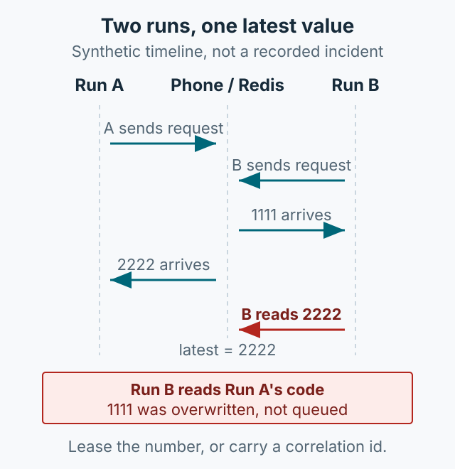

테스트 자동화에서 SMS 인증번호를 확인하는 일은 번거롭습니다. 테스트폰을 찾아가거나, 단말을 가진 동료에게 매번 요청해야 합니다. 이 글은 그 과정을 줄이기 위해 만든 내부 도구의 구조를 정리합니다. 원문은 테스트 유심폰을 서랍에 두고 있다면 앱을 설치해 테스트 번호를 공유할 수 있다는 편의를 강조했습니다. 그만큼 앱을 설치할 수 있는 사람이면 번호를 공유할 수 있다는 전제가 있었습니다. 승인 단말·발신자 제한·내부망 접근 제어는 원문에 구현 기록이 없으며, 지금 공개한다면 먼저 갖춰야 할 경계입니다.



*그림 1. 테스트 단말에서 수신한 인증번호를 내부 서버를 거쳐 Slack과 자동화 API로 전달하는 구조. Redis에는 짧은 TTL의 항목으로 유지됩니다.*

## 문제와 범위

여러 테스트 시나리오가 같은 테스트 번호를 사용하면, 인증번호를 누가 언제 받았는지 공유가 어렵습니다. 반대로 번호마다 담당자를 두면 인증이 필요한 순간에 사람을 기다려야 합니다. 그래서 “수신 사실과 인증번호를 짧은 시간 동안만 한곳에서 볼 수 있게 하자”는 목표를 세웠습니다.

도구는 세 부분으로 구성했습니다.

- **Android 앱**: 테스트 단말에서 SMS 수신을 감지하고 내부 서버로 전달합니다.
- **웹 서버**: 단말 등록, 최근 인증번호 조회, 실시간 화면 갱신을 담당합니다.
- **자동화 API**: 테스트 스크립트가 최근 인증번호를 조회할 수 있게 합니다.

## Android 수신과 권한

Android에서 SMS를 읽으려면 `RECEIVE_SMS` 권한이 필요합니다. 일반 SMS 수신과 SMS Retriever API는 동작이 다릅니다. SMS Retriever는 앱 해시가 포함된 형식의 문자만 읽을 수 있으므로, 목적에 따라 두 방식을 분리해 이해해야 합니다. 스토어 배포 앱은 Google Play의 SMS 권한 정책을 별도로 확인해야 합니다.

원문 코드는 `SmsMessage.createFromPdu((byte[]) pdu)`를 사용합니다. 이 단일 인자 메서드는 API 23에서 deprecated 되었고, 현재는 `createFromPdu(byte[] pdu, String format)` 오버로드를 사용해야 합니다. 자세한 내용은 [SmsMessage 공식 문서](https://developer.android.com/reference/android/telephony/SmsMessage)를 확인하세요.

```kotlin
// 개념 예시: 수신 문자에서 4자리 코드를 추출해 서버로 보낸다.
private fun forwardSms(body: String) {
    val code = Regex("\\b\\d{4}\\b").find(body)?.value ?: return
    webSocket.sendSmsData(code)
}
```

원문 예시는 특정 발신 번호를 코드에 직접 비교하고 Slack 채널 정보를 단말 등록 정보에서 받습니다. 지금 공개한다면 발신 번호 허용 목록과 채널 ID를 설정값으로 분리하고, 누가 단말을 등록·해제할 수 있는지도 제한해야 합니다.

## 서버와 저장 정책

서버는 FastAPI와 Redis로 구성했고, Docker로 내부 장비에 배포했습니다. 원문은 인증번호를 Redis에 10분간 TTL로 유지한다고 적었습니다. 웹 화면은 WebSocket으로 갱신하고, 테스트 스크립트는 최근 값만 조회합니다.

```python
# 개념 예시: 인증번호를 10분 TTL로 저장
await redis.set(f"sms:{phone_number}", code, ex=600)
```

Slack 알림은 단말별로 등록된 채널로 보냅니다. 알림에는 단말 번호, 인증번호, 수신 시각이 포함됩니다. 단말 설명, 관리자, Slack 채널은 Android 앱에서 입력하고 웹 UI에서 확인했습니다. WebSocket 세션은 최대 30분으로 두고, 브라우저 새로고침이나 종료 시 정리했습니다.

문자 전문과 인증번호를 로그에 남기지 않는 것, 보관 기간을 짧게 유지하는 것, 내부망 인증을 붙이는 것은 지금 공개한다면 지켜야 할 권고입니다. 원문에는 이런 통제를 구현했다는 기록이 없습니다.

## 자동화에 연결하기

테스트 코드는 인증이 필요한 시점에 최근 인증번호를 조회합니다. 로그인 시나리오에서 “문자 발송” 버튼을 누른 뒤 API를 폴링해 값이 나타나면 입력하는 방식입니다. 문자가 오지 않았을 때 무한정 기다리지 않도록 테스트 쪽에 타임아웃과 재시도 한도를 두는 것이 좋습니다.

```python
code = wait_for_sms(phone_number, timeout=60)
assert code, "SMS code was not received"
```

원문은 Jenkins로 5분마다 브랜치 변경을 확인해 웹 서버를 Docker로 배포하고 APK를 빌드하는 절차도 설명합니다. 이 도구로 줄어든 것은 “문자를 확인하기 위해 사람을 찾는 시간”입니다. 대신 단말 등록 정보와 Slack 채널을 관리해야 하고, 테스트 번호가 바뀌면 설정도 갱신해야 합니다.

## 정리

SMS 인증 자동화는 편리하지만, 권한과 개인정보 경계를 잘못 잡으면 위험해집니다. 원문의 구조는 Android 수신 앱, FastAPI·Redis·WebSocket 서버, Slack 알림, 최근 인증번호 조회 API로 정리됩니다. 여기에 승인 단말, 발신자 제한, 내부망 접근 제어, 짧은 보관 기간, 최소 로그를 더하는 것은 현재 권고입니다. 이 글의 코드는 당시 구조를 설명하기 위한 축약 예시이며, 현재 Android 버전과 사내 정책에 맞춰 다시 검토해야 합니다.
