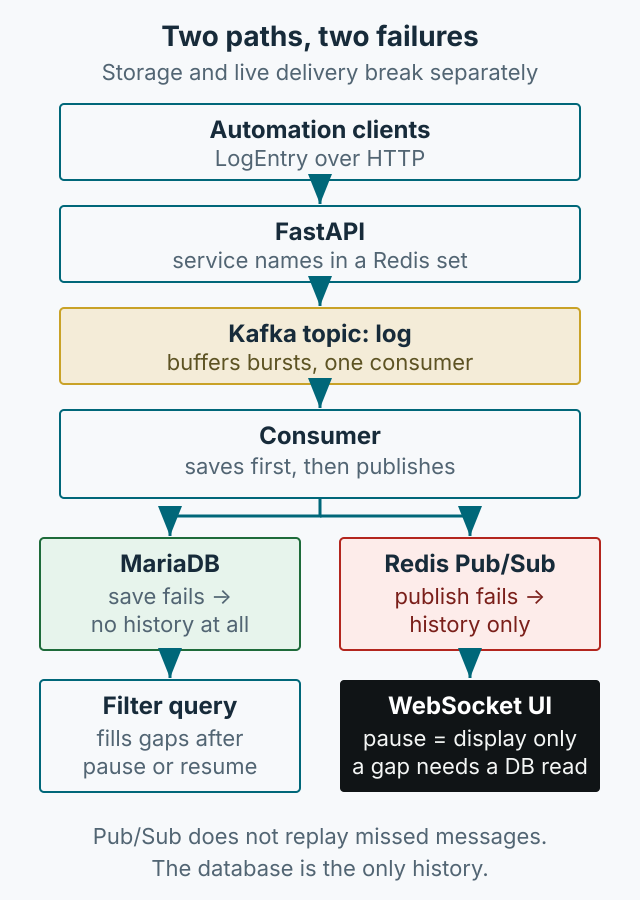

자동화 도구가 여러 개로 늘어나면 “지금 어디서 실패했는지”를 확인하는 일이 병목이 됩니다. New Relic, Datadog, Grafana 같은 도구가 이미 있지만, 간단한 로그 한 줄을 보려고 전체 관측 시스템을 붙이는 것은 과할 때가 있습니다. 이 글은 기존 API 서버에 Kafka와 Redis를 더해 작은 LogViewer를 만든 경험을 정리합니다. 핵심은 컴포넌트 목록이 아니라 **저장과 실시간 전달이 서로 다른 실패를 가진다는 점**입니다.



*그림 1. 저장 경로와 실시간 경로. 같은 로그가 두 경로를 지나므로, 어느 쪽이 끊겼는지 따로 확인해야 합니다.*

## 왜 Kafka를 넣었나

처음에는 API 서버가 로그를 받아 바로 DB에 쓰는 구조를 생각했습니다. 로그 발생량이 늘면 DB 쓰기가 요청 처리 속도를 떨어뜨릴 수 있기 때문입니다. 그래서 API 서버는 로그를 Kafka 토픽에 넣고, 별도 컨슈머가 저장과 실시간 전달을 맡도록 분리했습니다.

Kafka를 선택한 이유는 확장성과 병목 우려, 그리고 평소 관심 있던 기술을 적용해 보려는 것이었습니다. 원문에는 컨슈머의 오프셋 커밋 정책이 나오지 않습니다. 따라서 “offset을 언제 커밋했는지”를 이 글에서 주장할 수 없고, 재처리 여부도 알 수 없습니다.

지금의 판단은 별개입니다. 로그량이 크지 않고 소비자가 하나라면 Kafka는 운영 비용이 더 큽니다. 브로커, 토픽, 파티션, 컨슈머 그룹을 관리해야 하고, 장애 시 어디까지 처리됐는지 확인하는 일도 늘어납니다. 여러 소비자가 필요하거나 유입 폭주를 버퍼링해야 할 때 값어치가 생깁니다.

## 두 경로를 나눠서 본다

- **저장 경로**: API → Kafka → 컨슈머 → MariaDB. 나중에 조회할 수 있는 이력을 만듭니다.
- **실시간 경로**: 컨슈머 → Redis `log` 채널 → WebSocket → 브라우저. 지금 보고 있는 화면을 갱신합니다.

Redis Pub/Sub은 구독 중인 클라이언트에만 메시지를 전달합니다. Redis 문서는 Pub/Sub이 메시지를 저장하지 않으며, 구독하지 않은 동안의 메시지를 나중에 받을 수 없다고 설명합니다([Redis Pub/Sub 문서](https://redis.io/docs/latest/develop/pubsub/)). 즉 실시간 경로는 **놓친 전달을 재생하지 않습니다**. 놓친 로그를 다시 보려면 DB에서 읽어야 합니다.

원문 컨슈머는 DB 저장 후 Redis에 발행합니다. 다음은 순서를 설명하기 위해 줄인 예시이며, 원문을 그대로 옮긴 코드가 아닙니다.

```python
async for message in consumer:
    data = json.loads(message.value.decode("utf-8"))
    await save_log(data)
    await redis.publish("log", json.dumps(data))
```

순서가 중요합니다. DB 저장이 실패하면 그 아래 발행도 실행되지 않습니다. 이때 로그는 이력에도 실시간 화면에도 나타나지 않습니다. 반대로 발행이 실패하면 DB에는 남지만 화면에는 보이지 않습니다. 같은 “로그가 안 보인다”는 증상이 정반대 원인을 가질 수 있습니다.

## 일시정지는 수집을 멈추지 않는다

원문 웹 UI는 WebSocket으로 받은 로그를 화면에 추가합니다. 이때 `isPaused`가 참이면 표시만 건너뜁니다.

```javascript
if (!isPaused) {
    // 레벨·서비스·태그 필터를 통과한 로그만 화면에 추가
    addLogs([data]);
}
```

원문은 이 기능을 “실시간 일시정지/재개”라고 설명합니다. 화면을 멈춘 것이지 서버 수집이나 DB 저장을 멈춘 것이 아닙니다. 그리고 일시정지를 해제하거나 태그 필터를 바꾸면 `fetchLogsForService`가 실행되어 DB에서 해당 서비스의 로그를 다시 가져옵니다(원문 웹 UI 코드, `source` 328-368행). 원문의 주석은 “새로고침 할 경우에만 DB에서 가져온다”고 적지만, 실제 코드는 일시정지 해제와 필터 변경에서도 조회합니다.

이 차이가 운영에서 중요합니다. 사용자가 일시정지 상태에서 오래 머물면 화면에는 그동안의 로그가 없습니다. 재개하면 DB에서 다시 읽어 채워지므로 “사라진 것처럼” 보이지 않을 수 있습니다. 반대로 DB 저장이 실패한 구간은 재개해도 나타나지 않습니다. **일시정지 후 재개했을 때 로그가 보이는지**가 저장 경로와 실시간 경로를 구분하는 첫 확인이 됩니다.

## 실패를 구분하는 표

| 실패 지점 | 증상 | 확인할 증거 | 다음 조치 |
|---|---|---|---|
| API → Kafka 전송 실패 | 원문에서는 실패해도 API가 성공으로 응답할 수 있음 | 프로듀서 예외 로그, 실제 토픽 수신 여부 | 실패를 호출부에 전달하고, 응답과 실제 전달 결과를 대조한다. |
| 컨슈머 DB 저장 실패 | 실시간에도 이력에도 없음 | 컨슈머 예외 로그, DB 행 수 | 저장 실패를 알리고, 재처리 가능 여부를 확인한다. |
| Redis 발행 실패 | DB에는 있는데 화면에 없음 | DB 조회 결과와 화면 비교 | 새로고침·필터로 DB 조회가 되는지 확인한다. |
| 클라이언트 연결 끊김 | 끊긴 동안 로그가 화면에 없음 | WebSocket 종료 코드, 재연결 로그 | 재연결 후 DB를 다시 읽는지 확인한다. |
| 중복 수신 | 같은 로그가 두 줄 | 메시지 키, DB 중복 행 | 소비를 멱등하게 만들고 중복 키를 둔다. |

원문 프로듀서의 `send`는 예외를 잡아 로그만 남기고 호출부에 다시 던지지 않습니다. 따라서 API의 성공 응답만으로 Kafka 전달 성공을 확인할 수 없습니다. 반대로 컨슈머 예시에는 루프 내부의 예외 처리가 없어 DB 오류가 소비 루프 밖으로 전파될 수 있습니다. 태스크 감독·재시작 코드는 원문에 없으므로 자동 복구 여부는 알 수 없습니다.

“DB에는 있는데 화면에 없다”면 해당 로그의 실시간 경로부터 봅니다. “DB에도 없다”면 프로듀서의 성공 응답을 그대로 믿지 말고 실제 토픽 수신과 컨슈머 예외를 확인합니다. 이 순서를 정해 두면 같은 증상에서 다른 실패를 구분할 수 있습니다.

중복은 실시간 경로와 저장 경로 모두에서 생길 수 있습니다. 원문은 메시지 키를 `{service_name}_{timestamp}`로 만들지만, 컨슈머가 재처리하면 같은 로그가 두 번 저장될 수 있습니다. 원문에는 멱등 처리나 유니크 제약이 나오지 않으므로, 지금 만든다면 키에 유니크 제약을 걸고 재처리를 견디게 만드는 편이 좋습니다. exactly-once를 보장한다고 주장해서는 안 됩니다.

## 더 단순한 대안

이 구조가 과한 경우도 있습니다.

- **SSE**: 서버에서 클라이언트로 한 방향으로만 보내면 되고, 프록시와 재연결 처리가 단순합니다. 화면이 서버로 보낼 것이 없다면 WebSocket보다 관리하기 쉽습니다.
- **WebSocket**: 클라이언트가 서버로 업무 이벤트를 보내야 할 때 검토합니다. 원문 UI의 ping/pong은 연결 유지·상태 확인용이므로, 그것만으로 WebSocket이 SSE보다 필수라고 말할 수는 없습니다.
- **Kafka 없이**: 로그량이 적고 소비자가 하나라면 API가 DB에 직접 쓰고 SSE나 WebSocket으로 알리는 것으로 충분할 수 있습니다.
- **재생이 필요하면**: Redis Pub/Sub 대신 Redis Streams나 DB 폴링을 검토합니다. Pub/Sub은 재생을 제공하지 않습니다.

이것은 지금의 설계 판단이며, 원문 시스템을 실제로 이 구조로 바꿨다는 기록은 아닙니다.

## 운영에서 먼저 정할 것

무엇보다 먼저 정할 것은 로그에 무엇을 남기지 않을지입니다. 인증번호, 토큰, 주문 상세처럼 민감한 값은 로그 뷰어에 보내기 전에 클라이언트 단계에서 마스킹해야 합니다. 서비스별 보관 기간도 함께 정합니다.

UI는 단순하게 유지합니다. 서비스 선택, 태그·레벨 필터, 일시정지, 페이지네이션, 연결 상태 정도면 충분합니다. 기능을 더 넣기보다 “로그가 안 보일 때 원인을 알 수 있는가”를 기준으로 삼습니다. 연결이 끊겼다는 표시, DB 조회 실패 메시지, 일시정지 중 수집이 계속된다는 안내가 같은 기준에 포함됩니다.

## 정리

이 LogViewer는 완전한 관측 플랫폼이 아니라, 작은 내부 도구의 로그를 빠르게 확인하기 위한 장치입니다. 저장 경로와 실시간 경로를 나눠 보고, 일시정지가 표시만 멈춘다는 점을 알고, 실패 지점별 증거를 정해 두면 규모가 커지기 전까지 충분히 쓸 수 있습니다. 이 글의 코드는 당시 구현을 설명하기 위한 축약 예시이며, 현재 라이브러리 버전에 맞춰 검증한 코드는 아닙니다.
