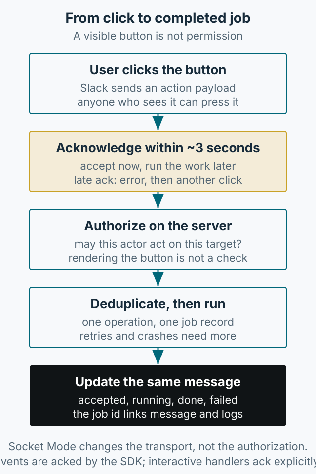

Slackbot의 첫 실행은 어렵지 않습니다. 토큰 두 개를 발급하고 이벤트 하나를 처리하면 됩니다. 어려운 부분은 그다음입니다. 채널에 보이는 버튼은 권한이 아니고, Slack이 이벤트를 받았다는 사실은 작업이 끝났다는 뜻이 아닙니다. 이 글은 초기 설정에서 한 걸음 더 나아가, 버튼 하나가 실제 업무를 실행할 때 무엇을 정해야 하는지 정리합니다.



*그림 1. Slack UI와 실제 작업 사이에는 ack, 권한 확인, 중복 방지, 상태 갱신이 필요합니다.*

## 왜 토큰 설정만으로는 부족한가

테스트 업무에서는 데이터 생성, 계정 초기화, 테스트 실행, 결과 확인 같은 반복 작업이 자주 생깁니다. 처음에는 수동으로 처리했지만, 빈도가 낮은 작업은 절차를 잊어버리기 쉽고 다른 팀이 같은 질문을 반복합니다. Slackbot으로 이 절차를 한곳에 모으면 찾는 시간이 줄어듭니다.

문제는 “누구나 쓸 수 있는 버튼”이 “아무나 실행할 수 있는 권한”이 된다는 점입니다. 원문은 테스트 편의를 위해 인증 횟수 초기화, 계정 고유 식별 값 조회, 포인트 충전, 주문 처리 같은 기능을 만들었다고 적었습니다. 이런 작업은 결과가 상태를 바꾸므로, 버튼을 보이게 하는 조건과 실제 실행을 허용하는 조건을 서버에서 따로 판단해야 합니다.

## Socket Mode를 선택한 이유

원문에는 웹 서버를 열고 RTM으로 봇을 운영하던 방식에서 Socket Mode로 옮긴 이유가 나옵니다. 인터랙티브 메시지를 쓰려면 Slack의 요청이 사내 PC로 들어와야 하는데, 보안상 외부에서 사내망으로 직접 요청을 보내는 것이 어려웠습니다.

Socket Mode는 공인 HTTP 엔드포인트를 열지 않고 아웃바운드 WebSocket 연결로 동작합니다. 사내망에서 아웃바운드가 허용된다면 리버스 프록시 없이 운영할 수 있다는 것이 장점입니다. 다만 Socket Mode는 **연결 방식**을 바꿀 뿐입니다. 클릭한 사람이 그 작업을 할 권한이 있는지, 같은 요청이 두 번 실행돼도 되는지는 여전히 서버가 판단해야 합니다.

## 필요한 토큰과 최소 범위

Slack 앱에는 두 종류의 토큰이 있습니다.

- **Bot Token**(`xoxb-`): 워크스페이스 안에서 봇이 메시지를 보내고 채널에 참여하는 권한입니다. 원문 예제의 멘션 수신과 답장에는 `app_mentions:read`와 `chat:write`가 필요합니다.
- **App-Level Token**(`xapp-`): Socket Mode 연결처럼 앱 전체 수준의 기능에 사용합니다. `connections:write`가 필요합니다.

범위를 넓히면 편하지만, 필요한 것만 추가하는 편이 사고 범위를 줄입니다. 버튼과 모달을 쓰려면 Interactivity를 켜야 하고, 그때 필요한 scope는 사용하는 기능에 따라 다르므로 [Slack scope 문서](https://api.slack.com/scopes)에서 확인해야 합니다. scope를 바꾼 뒤에는 워크스페이스에 다시 설치해야 할 수 있습니다.

토큰은 코드에 넣지 않습니다.

```python
import os
from slack_bolt.async_app import AsyncApp

app = AsyncApp(token=os.environ["SLACK_BOT_TOKEN"])
```

## ack는 완료가 아니다

Slack은 인터랙션을 받으면 제한 시간 안에 응답을 기대합니다. Bolt 문서는 actions, commands, shortcuts, options, view submissions에 ack가 필요하고, 보통 3초 안에 보내야 한다고 설명합니다([Bolt acknowledge 문서](https://docs.slack.dev/tools/bolt-python/concepts/acknowledge/)). 이 3초는 “작업을 끝내라”는 시간이 아니라 “요청을 받았다”고 알려 주는 시간입니다. ack가 늦으면 사용자에게 오류가 표시되고, 사용자가 다시 눌러 같은 작업을 두 번 시작할 수 있습니다([인터랙션 응답 문서](https://docs.slack.dev/interactivity/handling-user-interaction/)).

버튼 재클릭과 이벤트 전달 재시도는 구분해야 합니다. [HTTP Events API](https://docs.slack.dev/apis/events-api/)는 실패한 이벤트 전달을 자동 재시도하며 `x-slack-retry-num` 헤더를 보냅니다. 이 규칙을 버튼 action에 그대로 적용하면 안 됩니다. Socket Mode의 envelope 수신 확인도 SDK가 처리하는 별도 전송 계층입니다. 버튼 중복 방지는 자동 재전송 여부를 가정하기보다 사용자 재클릭과 오래된 메시지의 버튼까지 고려해 설계합니다.

이벤트는 SDK가 처리합니다. 원문의 `app_mention` 핸들러처럼 `say`로 답하는 예제는 SDK가 이벤트 응답을 처리하므로, 모든 이벤트 핸들러에 수동 ack를 넣어야 하는 것은 아닙니다. 반면 버튼 action 핸들러는 ack를 명시해야 합니다.

아래는 같은 클릭을 처리할 때 서버가 남겨야 할 상태의 예시입니다. 실제 payload 필드 이름은 이벤트 종류와 Slack 버전에 따라 다르므로, 구현 전에 해당 payload 문서를 확인해야 합니다.

| 순서 | 들어오는 것·상태 | 서버가 하는 일 | 남길 것 |
|---|---|---|---|
| 1. 수신 | action payload (actor, channel, message `ts`, action id, target) | 동일 작업을 식별할 operation id를 정한다. 예: 버튼 value에 서버가 발급한 ID | payload 원문, operation id |
| 2. 접수 | 3초 응답 기한 | `ack()`로 접수만 알린다 | 접수 시각 |
| 3. 권한 | actor와 action/target | actor 허용 여부와 target/action 실행 권한을 함께 확인한다 | 판정 결과와 근거 |
| 4. 중복 전달 | 같은 operation id가 이미 기록됨 | 새 실행을 시작하지 않고 기존 상태를 보여 준다 | 기존 job id, 상태 |
| 5. 더블클릭 | 같은 operation id | 4와 같은 경로로 묶는다 | 클릭 횟수 |
| 6. 나중의 의도적 재실행 | 새 operation id | 새 작업으로 접수한다 | 새 job id |
| 7. 실행·장애 | 작업 레코드, 큐 전달, 워커 | 내구성 있는 작업 결과를 남기고, 하류 작업도 멱등하게 만든다 | job id, 시도 횟수, 최종 상태 |
| 8. 완료 | 결과 | `chat.update`로 같은 메시지를 갱신한다 | 성공·실패와 이유 |

중복 전달과 더블클릭은 같은 operation id로 묶지만, 나중에 사용자가 의도적으로 다시 실행하는 것은 새 operation id여야 합니다. 이 구분이 없으면 “한 번만 실행”이 정상적인 재실행까지 막습니다.

operation id만으로 exactly-once가 보장되지는 않습니다. `SET NX`와 TTL 잠금은 동시 중복을 줄일 뿐, TTL 만료, 워커 크래시, 큐 전달 유실, 서로 다른 두 권한자가 같은 대상에 실행하는 경우가 남습니다. 그래서 작업 결과를 내구성 있게 저장하고, 하류 작업에 자체 멱등 키를 두거나 주기적으로 상태를 대조해야 합니다. 멱등 키의 범위는 작업의 의미에 맞춰 워크스페이스·action·target을 포함해야 하며, actor만으로는 부족합니다.

## 작업 흐름: 접수, 권한, 중복, 실행, 상태

| 단계 | Slack이 보는 것 | 서버가 보장해야 하는 것 |
|---|---|---|
| 버튼 클릭 | action payload 도착 | 3초 안에 ack |
| 권한 | 누가 눌렀는지 | 그 사용자가 그 action과 target을 실행할 권한이 있는지 |
| 중복 | 사용자 재클릭·더블클릭 가능 | 같은 operation id를 한 작업으로 묶는다. 크래시·TTL 만료·동시 실행은 별도 보장이 필요하다 |
| 실행 | 아무것도 보이지 않음 | 작업 ID와 진행 상태 기록 |
| 완료 | 메시지 갱신 | 성공/실패를 사용자가 볼 수 있게 표시 |

버튼을 숨기는 것만으로는 부족합니다. 사용자는 버튼을 다시 누르거나 오래된 메시지에 남아 있는 버튼을 누를 수 있습니다. 그래서 권한 확인은 UI 렌더링이 아니라 action 핸들러에서 매번 해야 합니다. 채널 ID나 사용자 ID를 payload에서 읽는 것과, 그 사용자가 지금 그 작업을 할 권한이 있는지 확인하는 것은 다른 일입니다.

원문에는 이런 승인 절차를 운영 환경에 구현했다는 기록이 없습니다. 승인된 실행자 목록과 대상별 실행 권한은 지금 설계한다면 먼저 정할 경계입니다.

## 상태를 보이게 만들기

작업이 오래 걸린다면 사용자는 봇이 멈춘 건지 실행 중인지 알 수 있어야 합니다. 최소한 세 가지를 남깁니다.

1. **작업 ID**: 로그와 메시지를 연결하는 키입니다.
2. **진행 상태**: 접수, 실행 중, 완료, 실패.
3. **결과와 실패 이유**: 성공만 표시하면 재시도 판단을 할 수 없습니다.

`chat.update`로 같은 메시지를 갱신하면 채널에 메시지가 쌓이지 않고, 실패했을 때도 같은 위치에서 결과를 볼 수 있습니다. 작업 ID를 응답에 포함해 두면 사용자가 문의할 때 로그를 바로 찾을 수 있습니다.

## 실행 방식과 운영 팁

여러 사용자의 이벤트를 동시에 처리해야 한다면 `AsyncApp`과 `AsyncSocketModeHandler`가 한 선택지입니다. 동기 Bolt 핸들러도 스레드 풀에서 실행될 수 있으므로, “동기라서 다른 이벤트가 모두 기다린다”고 단정할 수는 없습니다. 다만 비동기라고 해서 업무 작업을 ack 앞에서 실행해도 된다는 뜻은 아닙니다. 접수와 실행을 분리하는 편이 안전합니다.

운영에서는 다음을 권합니다.

- 토큰은 환경 변수나 비밀 관리 도구에 보관합니다.
- 봇이 실행할 수 있는 명령의 범위를 코드가 아니라 서버 권한 데이터로 관리합니다.
- 파괴적인 작업은 확인 절차와 실행 이력을 남깁니다.
- 채널 초대와 scope 변경 후 재설치 필요 여부를 확인합니다.

예제 저장소는 [slackbot-sample](https://github.com/kimkitae/slackbot-sample)에 있습니다. Docker 실행 방법은 저장소의 현재 README를 기준으로 확인하세요. 이 글은 초기 설정과 작업 경계까지 다뤘고, Modal View의 전체 구현은 다루지 않았습니다.
