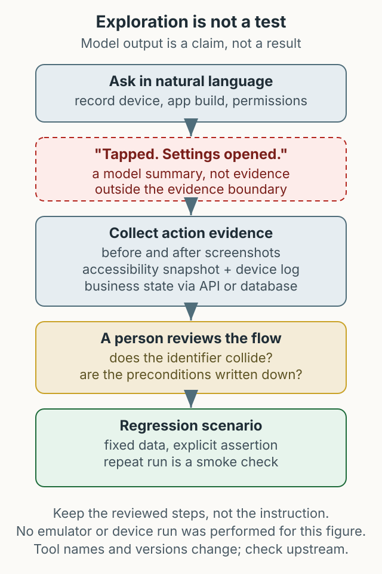

MCP(Model Context Protocol)는 AI 도구가 외부 시스템의 도구를 호출할 수 있게 해 주는 규약입니다. 모바일 자동화에 붙이면 “이 화면에서 이 버튼을 찾아 눌러 줘”를 자연어로 시도할 수 있습니다. 편리하지만 위험한 지점도 같은 곳에 있습니다. 모델이 “완료했습니다”라고 말한 것과 실제로 그 동작이 일어났다는 것은 다릅니다. 이 글은 연결 방법과 함께, 탐색적 사용과 결정적 회귀 검증을 어떻게 나눌지 정리합니다.



*그림 1. 탐색 결과는 증거를 거쳐 검토되어야 회귀 시나리오가 됩니다. 모델의 완료 메시지는 그 자체로 증거가 아닙니다.*

## 탐색과 회귀는 다른 문제다

| 항목 | 탐색적 사용 | 결정적 회귀 검증 |
|---|---|---|
| 목적 | 화면 구조와 동작을 빠르게 파악 | 같은 결과가 반복되는지 확인 |
| 입력 | 자연어 지시 | 고정된 시나리오와 데이터 |
| 판정 | 사람이 화면과 로그를 확인 | 자동 assertion과 실패 증거 |
| 실패 시 | 다음 시도를 결정 | 원인 분류와 재현 절차 |
| 적합한 단계 | 새 기능 탐색, 빠른 확인 | 배포 전 반복 검증 |

MCP 기반 도구는 왼쪽에 강합니다. 접근성 스냅샷을 읽어 화면 요소를 나열하고, 탭·입력·스크린샷을 실행할 수 있습니다. Appium처럼 세션과 셀렉터를 직접 관리하지 않아도 되므로 시작 비용이 낮습니다. 반면 오른쪽에서는 아직 보조 수단입니다. 같은 자연어 지시가 같은 결과를 낸다는 보장이 없고, 모델의 판단이 assertion을 대신할 수 없기 때문입니다.

## 현재 upstream 기준으로 설정하기

패키지 이름과 도구 목록은 배포 상태에 따라 바뀝니다. 이 글의 설정은 작성 시점의 예시이며, 설치 전에 [Mobile MCP 저장소](https://github.com/mobile-next/mobile-mcp)의 현재 안내를 확인해야 합니다. 저장소 문서에는 연결 가능한 디바이스 목록을 다루는 내용과 Mobilewright 예제가 있으며, 구체적인 도구 이름은 버전에 따라 달라질 수 있습니다.

```bash
node --version
xcode-select -p
adb version
```

Cursor는 사용자 전역 `~/.cursor/mcp.json`과 프로젝트 `.cursor/mcp.json`을 모두 사용할 수 있습니다. 어느 쪽에 등록했는지 기록하십시오.

```json
{
  "mcpServers": {
    "mobile-mcp": {
      "command": "npx",
      "args": ["-y", "@mobilenext/mobile-mcp@latest"]
    }
  }
}
```

Claude Desktop은 macOS 기준 `~/Library/Application Support/Claude/claude_desktop_config.json`을 사용합니다. 기존 설정이 있으면 `mcpServers` 객체를 합치고 JSON 문법을 확인합니다.

`@latest`는 시점에 따라 다른 버전을 가리킵니다. 재현성이 필요하면 설치 후 실제로 해석된 버전을 기록하고, 같은 실험을 반복할 때 그 값을 고정합니다.

## 디바이스와 권한 경계

- **iOS 시뮬레이터**: `xcrun simctl list devices`로 확인하고 부팅합니다. 실제 단말은 신뢰 설정이 필요합니다.
- **Android 에뮬레이터**: AVD 이름과 API 레벨을 기록합니다. 실제 단말은 USB 디버깅과 드라이버 상태를 확인합니다.
- **조직 정책**: 허용된 테스트 단말만 사용합니다. 회사 계정이 로그인된 단말을 탐색에 쓰면 계정 상태가 바뀔 수 있습니다.

모델은 접근성 정보에 없는 것을 “없다”고 단정하기 쉽습니다. 접근성 레이블이 없는 버튼, WebView 내부 요소, 캔버스로 그린 화면은 목록에 나타나지 않을 수 있습니다. 좌표 기반 탭은 해상도와 화면 배율에 민감합니다. 그래서 “요소를 찾지 못했다”는 응답은 화면에 없다는 뜻이 아니라 **접근성 트리에서 찾지 못했다**는 뜻으로 읽어야 합니다.

## 완료 메시지 대신 증거를 요구한다

MCP 도구 호출의 결과에는 텍스트 요약, 이미지, 구조화된 결과가 모두 올 수 있습니다. “탭했습니다”, “설정을 열었습니다” 같은 모델의 문장은 실제 관찰된 도구 출력과 구분해야 하며, 그 자체가 화면 상태의 증거는 아닙니다. 최소한 다음을 함께 남깁니다.

1. **동작 전후 스크린샷**: 같은 화면인지, 실제로 바뀌었는지 비교합니다.
2. **접근성 스냅샷**: 대상 요소의 식별자와 위치를 기록합니다.
3. **기기 로그 또는 앱 상태**: 크래시가 났는지, 화면 전환이 일어났는지 확인합니다.
4. **업무 상태**: API 조회나 DB 상태로 결과를 확인합니다.

스크린샷만으로는 “버튼이 눌렸다”를 증명하기 어렵고, 스냅샷만으로는 “화면이 실제로 바뀌었다”를 증명하기 어렵습니다. 두 증거가 같은 방향을 가리켜야 동작으로 인정할 수 있습니다.

## 탐색한 흐름을 회귀 시나리오로 바꾸기

아래는 새로 제안하는 작업 방식의 예시입니다. 특정 앱이나 실제 계정이 아니라, 탐색 결과를 어떻게 결정적 테스트로 옮기는지를 설명합니다.

1. **탐색**: “설정 화면에서 알림 토글을 끄고 다시 켜 줘”라고 요청합니다.
2. **기록**: 모델이 사용한 요소 식별자, 화면 전환, 걸린 시간, 실패한 시도를 남깁니다. 같은 지시를 두 번 실행하면 스모크 확인은 되지만, 두 번의 일치가 결정성을 증명하지는 않습니다.
3. **검토**: 사람이 스크린샷과 스냅샷을 보고, 사용한 식별자가 다른 요소와 겹치지 않는지 확인합니다. 겹치면 회귀 시나리오에 쓰지 않습니다.
4. **고정**: 확인된 전제(기기 모델, OS 버전, 앱 빌드, 로케일, 초기 권한 상태)와 동작, assertion을 기존 프레임워크의 시나리오로 옮깁니다. 새 경로를 찾는다면 upstream README의 Mobilewright 예제도 비교할 수 있습니다. 이 글에서 해당 도구로 시나리오를 실행한 것은 아닙니다.
5. **검증**: 같은 시나리오를 두 번 실행합니다. 두 번째가 실패하면 정리 누락뿐 아니라 대기 시간, 환경, 불안정한 로케이터, 제품 결함도 확인하십시오. 실패 하나가 정리 단계 누락을 증명하지는 않습니다.

이 과정에서 중요한 것은 “모델이 성공했다”가 아니라 “사람이 검토한 재현 가능한 단계가 남았다”입니다. 자연어 지시를 그대로 테스트로 저장하면, 모델이나 UI가 바뀔 때 같은 지시가 다른 동작을 합니다.

## 파괴적 동작과 권한

MCP 도구는 실제 단말을 조작합니다. 결제, 계정 삭제, 로그아웃처럼 되돌리기 어려운 동작은 탐색 중에도 확인 절차를 두어야 합니다. 실수로 실행되지 않도록 다음을 정합니다.

- 허용할 도구와 앱 범위를 정하고, 테스트 계정만 사용합니다.
- 파괴적 동작은 사람이 확인한 뒤 실행합니다.
- 도구 호출 로그와 실패 스크린샷을 보관합니다.
- 모델이 만든 시나리오는 실행 전에 사람이 검토합니다.

보안이 중요한 흐름은 아직 MCP 탐색에 맡기지 않는 편이 안전합니다. AI가 QA를 대체한다는 주장도 이 글의 근거가 아닙니다. 이 도구가 줄여 주는 것은 탐색과 반복 입력의 시간입니다.

## 검증 범위

이번 개정에서는 실제 에뮬레이터나 단말에서 MCP 서버를 실행해 보지 않았습니다. 저장소의 현재 문서와 예제를 확인한 범위이며, 도구 이름과 결과 형식은 버전에 따라 달라질 수 있습니다. 설치 후에는 반드시 연결 확인, 기기 목록, 한 번의 탭과 스크린샷까지 직접 확인하십시오.

## 정리

MCP 기반 모바일 도구는 탐색의 진입 비용을 낮춥니다. 그 결과를 회귀 검증으로 옮기려면 동작 증거, 사람의 검토, 재현 가능한 전제가 필요합니다. 모델의 완료 메시지를 assertion으로 쓰지 않고, 스크린샷·스냅샷·업무 상태를 함께 남기는 것이 지금의 기준입니다.
