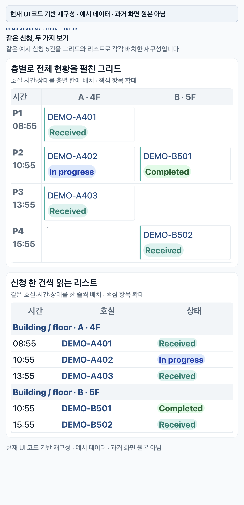

필리핀 어학원에서 처음 AX 도입을 시작할 때, 기능 개발만 보면 2주 정도면 될 것 같았다. 종이로 받던 신청을 화면으로 옮기고, 정해진 업무 규칙을 구현하면 된다고 생각했다.

실제로 오래 걸린 일은 구성원들이 제품을 쓰게 만드는 과정이었다. 그 차이를 가장 선명하게 보여준 것이 청소신청 화면과 수업 배정이었다. 하나는 사용자가 정보를 읽는 방식, 다른 하나는 업무를 결정하는 방식에 관한 문제였다.

## 그리드와 리스트 중 무엇이 더 좋은가보다 먼저 볼 것

각종 신청을 종이로 처리하던 환경에서 청소신청을 전산화했다. 컴퓨터에 익숙하지 않은 직원들은 메뉴를 찾는 단계부터 어려워했다. 나는 그 정도 조작은 다들 할 수 있을 거라고 생각했다.

신청 내역은 처음에 건물과 층별 그리드로 구성했다. 전체 현황이 한눈에 보이니 깔끔하고 편할 것 같았다. 그런데 직원들은 단순한 리스트를 더 좋아했고, 그 형태를 더 쉽게 이해했다.

*현재 UI 코드의 구성과 스타일로 재구성한 그림이다. 같은 예시 신청 5건을 사용했으며 과거 화면의 원본 캡처는 아니다.*

이 경험을 설계 문제로 다시 해석하면, 한 화면에 정보를 모아 놓는 것과 사용자가 처리할 항목을 찾는 것은 다른 과제다. 그리드는 위치와 분포를 비교하기에 좋지만, 사용자는 행과 열을 해석해 자기 작업을 찾아야 한다. 리스트는 신청 한 건을 읽는 단위로 삼는다. 어느 쪽을 기본 화면으로 둘지는 먼저 해야 할 일에 따라 달라진다.

다음은 화면을 고를 때 사용할 수 있는 비교 기준이다. 당시 직원들의 발언을 재현한 표는 아니다.

| 화면에서 먼저 해야 할 일 | 우선 검토할 배치 | 확인할 점 |
|---|---|---|
| 어느 층·시간에 신청이 몰렸는지 비교 | 그리드 | 행·열의 의미를 설명하지 않아도 읽는가 |
| 신청 한 건의 상태와 다음 행동 찾기 | 리스트 | 대상을 찾고 처리 버튼까지 이어지는가 |
| 전체 현황도 보고 개별 건도 처리 | 작업용 기본 화면 + 별도 전체 보기 | 매번 보기 방식을 바꿔야만 일할 수 있는가 |

다음에 같은 화면을 검증한다면, 디자인을 보여주고 마음에 드는지 묻는 데서 멈추지 않겠다. 예시 신청 한 건을 주고 도움 없이 입구를 찾는지, 해당 신청을 여는지, 처리 후 상태를 확인하는지 보겠다. 화면 선호와 실제 작업 수행을 따로 확인하는 방법이다.

## 페이지가 멈췄을 때, 사용자가 알아야 할 것

페이지 전환이 안 되는 오류 하나로 직원들이 크게 혼란스러워했던 일도 있었다. 여기서 살펴볼 것은 오류 메시지의 문구뿐 아니라 **사용자의 요청이 어디까지 처리됐는가**다.

예를 들어 신청 버튼을 누른 뒤 화면이 멈췄다고 하자. 다음은 실제 사건의 복구 기록이 아니라, 같은 유형의 문제를 점검할 때 쓸 진단표다.

| 확인된 상태 | 사용자가 겪는 불확실성 | 다음 확인·안내 |
|---|---|---|
| 서버에 신청이 없음 | 다시 눌러야 하는가 | 실패를 알리고 재시도 경로 제공 |
| 신청은 저장됐지만 다음 화면이 안 열림 | 접수됐는가 | 저장된 신청을 조회해 접수 상태 표시 |
| 응답이 끊겨 저장 여부를 모름 | 다시 누르면 중복되는가 | 요청 식별자로 상태 확인 후 재시도 판단 |

저장 여부를 모르는 상태를 곧바로 실패로 표시하면 재입력을 유도할 수 있다. 반대로 저장을 확인하지 않고 성공이라고 표시하면 사용자가 처리가 끝났다고 믿는다. 기능 완료 기준에 정상 화면뿐 아니라 이런 중간 상태의 안내도 들어가야 한다고 본다.

## 세 달 넘게 배정 규칙을 다시 읽은 이유

아카데미의 수업 배정은 규칙이 있으니 쉬울 것 같았다. 하지만 세 달이 넘도록 마무리하지 못했고, 선생님 배정이 안 된다는 리포트를 계속 받았다. 배정 로직에 문제가 있는지 전체 규칙을 수차례 다시 검토했다.

그 과정에서 중요한 차이를 찾았다. 시스템은 학생과 선생님의 과목·레벨을 비교했다. 현장에서는 담당자가 그 조건 외에도 이 학생에게 어떤 선생님이 필요한지 판단해 직접 배정하고 있었다.

규칙을 만족하는 결과와 현장이 기대하는 결과가 어긋날 수 있는 구조였다. 이 차이를 확인하지 않으면 서로 다른 현상을 모두 ‘배정 오류’라고 부르게 된다.

지금 이 문제를 다시 진단한다면 다음 세 유형부터 나누겠다.

| 배정 결과가 기대와 다를 때 | 먼저 구분할 것 |
|---|---|
| 합의한 조건에 맞는 후보가 있는데 누락됨 | 데이터·구현이 규칙을 제대로 적용했는지 |
| 후보가 전혀 없음 | 조건이 충돌하는지, 실제 가능한 자원이 부족한지 |
| 규칙대로 나왔지만 다른 교사가 필요함 | 담당자의 학생별 판단을 처리할 경로가 있는지 |

내가 현장에서 뒤늦게 파악한 차이는 세 번째에 해당했다. 과목·레벨 비교에 담기지 않은 담당자의 학생별 판단이 있었다. 앞의 두 경우와 세 번째 경우는 고칠 곳이 다르다. 담당자의 선택을 표현할 방법이 없는데 매칭 로직만 계속 고쳐서는 그 요구를 해결하기 어렵다.

## 자동화할 규칙과 사람이 선택할 지점을 함께 정하기

현장과 합의하면서 배정 규칙을 하나의 기준으로 정형화했다. 특정 조건에서는 담당자가 필요한 선생님을 직접 배정할 수 있도록 별도 수동 경로도 두었다.

이 경험을 다시 설계한다면, 규칙을 다음처럼 나눠 검토하겠다. 아래 분류와 통제 항목은 독자를 위한 설계 예시이며 당시 구현한 기능 목록은 아니다.

| 구분 | 다루는 방식 |
|---|---|
| 어기면 운영이 성립하지 않는 제약 | 자동·수동 배정 모두에서 확인. 예: 실제 시간 중복 |
| 기본 후보를 고르는 기준 | 과목·레벨처럼 자동 매칭에 사용 |
| 학생별로 담당자가 판단할 부분 | 수동 선택을 허용할 조건과 범위를 합의 |

수동 배정을 허용한다고 모든 제약을 없애야 하는 것은 아니다. 무엇을 바꿀 수 있고 무엇은 계속 확인해야 하는지 나눠야 한다. 운영을 점검할 자료도 자동 배정 결과, 담당자가 바꾼 결과, 바꾼 이유를 구분해 남기는 편이 좋다. 그래야 다음 문제가 구현 오류인지, 규칙 변경 요청인지, 합의한 예외인지 판단할 수 있다.

지금 내게 프로젝트 빌더의 일은 이런 합의와 확인까지 포함한다. 기능을 만든 뒤 현장에 넘기는 일정만으로는 실제 사용에 필요한 작업을 다 담을 수 없었다. 다음 프로젝트에서는 도움 없는 작업 수행과 대표 배정 사례의 합의를 초기 완료 기준에 넣겠다.

---

비슷한 업무 전산화나 AX 도입을 고민하고 있다면 [kimkitae@kflowlabs.com](mailto:kimkitae@kflowlabs.com)으로 이야기해 주세요.
