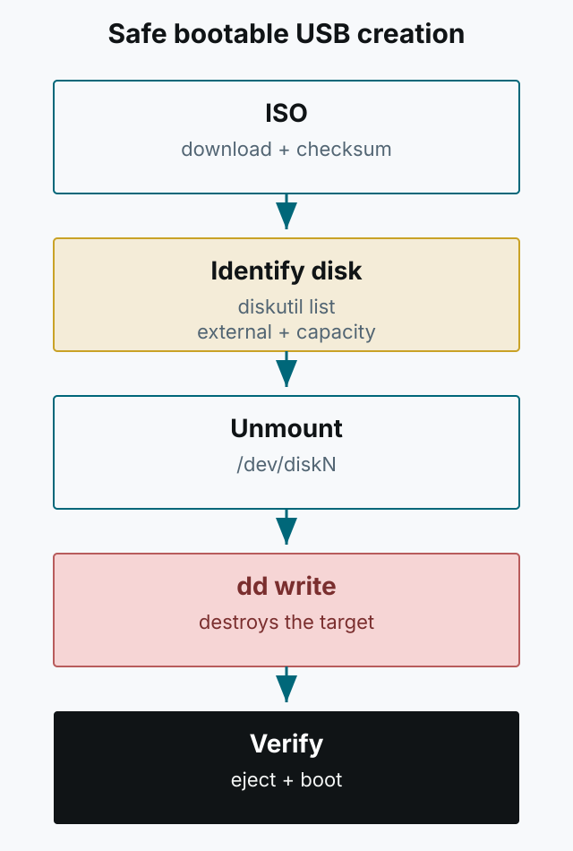

LG그램 노트북에 Ubuntu를 설치하면서 맥에서 부팅 USB를 만든 과정을 정리합니다. `dd`는 잘못된 디스크를 지정하면 해당 디스크의 데이터를 되돌릴 수 없이 지웁니다. 아래 명령을 실행하기 전에 대상이 정말 USB인지 반드시 확인하세요.



*그림 1. 부팅 USB를 만들 때의 안전한 순서. 대상 디스크 확인과 마운트 해제가 먼저입니다.*

## 준비물

- Ubuntu Desktop 또는 Server ISO ([다운로드](https://ubuntu.com/download))
- 4GB 이상 USB 드라이브
- macOS의 `디스크 유틸리티`, `diskutil`, `dd`

## USB 포맷과 ISO 변환

`디스크 유틸리티`에서 USB를 선택하고 `MS-DOS(FAT32)`로 포맷합니다. 이후 터미널에서 ISO를 UDRW 형식으로 변환합니다.

```bash
hdiutil convert -format UDRW -o ubuntu.img ubuntu.iso
mv ubuntu.img.dmg ubuntu.img
```

`hdiutil convert`의 출력 확장자는 `.dmg`이므로, `dd`에 사용할 파일 이름으로 바꿔 둡니다. 원본 ISO는 그대로 보관하는 편이 좋습니다.

## 대상 디스크 확인

가장 중요한 단계입니다. `diskutil list`로 전체 디스크와 USB의 식별자를 확인합니다.

```bash
diskutil list
```

USB는 보통 `external, physical`로 표시됩니다. 용량과 이름을 함께 확인하고, 내장 디스크(`/dev/disk0` 등)를 절대 지정하지 마세요. 아래 예시의 `/dev/diskN`은 실제 값으로 바꿔야 하며, 그대로 복사하면 안 됩니다.

```bash
diskutil unmountDisk /dev/diskN
```

마운트 해제가 되지 않으면 `Resource busy` 오류가 납니다. 이때는 어떤 프로세스가 사용 중인지 확인한 뒤, 필요하면 `diskutil unmountDisk force /dev/diskN`을 사용합니다. 그래도 해제되지 않으면 재부팅 후 다시 시도하는 편이 안전합니다.

## dd로 기록하기

대상이 USB임을 다시 확인한 뒤 기록합니다.

```bash
sudo dd if=./ubuntu.img of=/dev/rdiskN bs=4m
```

macOS에서는 `/dev/rdiskN`(raw device)을 사용하면 더 빠른 경우가 있습니다. `bs` 값은 환경에 따라 조정할 수 있습니다. 기록이 끝날 때까지 기다리고, 중간에 USB를 빼지 마세요.

## 마무리와 검증

```bash
diskutil eject /dev/diskN
```

`diskutil list`로 파티션 구조가 바뀐 것을 확인할 수 있습니다. 가능하면 대상 노트북에서 부팅해 설치 화면이 뜨는지 확인하세요. 부팅이 되지 않으면 ISO가 손상되지 않았는지, USB가 정상인지, 보안 부팅 설정이 맞는지 차례로 점검합니다.

이 글은 특정 디스크 번호를 가정하지 않습니다. `dd` 명령은 대상 확인 없이 실행하지 말고, 중요한 데이터가 있는 디스크에서는 절대 사용하지 마세요.
