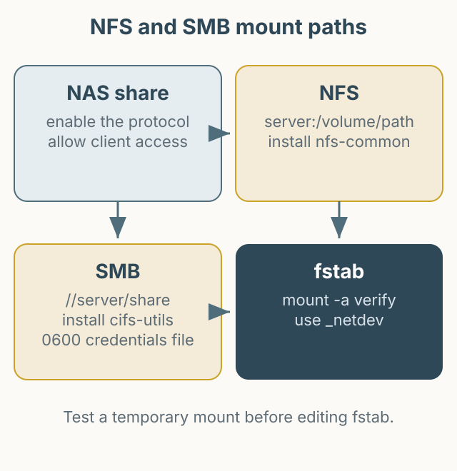

NAS의 공유 폴더를 Ubuntu 서버에 마운트하는 방법을 정리합니다. NFS와 SMB는 설정 방식이 다르므로, 사용할 프로토콜을 먼저 정하고 해당 절만 따라가는 것이 좋습니다. 아래 IP와 경로는 설명을 위한 예시이며, 실제 환경의 값으로 바꿔야 합니다.



*그림 1. NFS와 SMB를 각각 설정하고, 임시 마운트로 확인한 뒤 자동 마운트를 등록하는 순서.*

## NFS 설정

NAS 관리 화면에서 NFS 서비스를 활성화하고, 공유 폴더의 NFS 권한에 클라이언트 서버의 IP를 등록합니다. 가능하면 특정 IP만 허용하고, 모든 사용자에게 쓰기 권한을 주는 설정은 피하세요.

Ubuntu에는 `nfs-common`이 필요합니다.

```bash
sudo apt update
sudo apt install nfs-common
sudo mkdir -p /mnt/nas-nfs
```

먼저 임시로 마운트해 연결을 확인합니다. 아래 `192.0.2.10`은 문서용 예시 주소입니다.

```bash
sudo mount -t nfs 192.0.2.10:/volume1/shared /mnt/nas-nfs
findmnt /mnt/nas-nfs
```

정상임을 확인한 뒤 `/etc/fstab`에 추가합니다.

```fstab
192.0.2.10:/volume1/shared /mnt/nas-nfs nfs defaults,_netdev 0 0
```

`_netdev`는 네트워크가 준비된 뒤 마운트하라는 뜻입니다. 적용 전에 `sudo mount -a`로 문법과 연결을 확인하고, 오류가 나면 fstab을 바로 수정하세요.

## SMB 설정

SMB는 `cifs-utils`가 필요합니다.

```bash
sudo apt update
sudo apt install cifs-utils
sudo mkdir -p /mnt/nas-smb
```

임시 마운트로 먼저 확인합니다. 비밀번호를 명령행에 직접 쓰면 셸 기록과 프로세스 목록에 남을 수 있으므로, 아래처럼 자격 증명 파일을 사용하는 편이 안전합니다.

```bash
sudo mkdir -p /etc/samba
sudo install -m 600 /dev/null /etc/samba/credentials-nas
sudo tee /etc/samba/credentials-nas >/dev/null <<'EOF'
username=your_user
password=your_password
EOF
```

파일 소유자는 root, 권한은 `0600`이어야 합니다.

```bash
sudo chown root:root /etc/samba/credentials-nas
sudo chmod 600 /etc/samba/credentials-nas
sudo mount -t cifs //192.0.2.10/shared /mnt/nas-smb \
  -o credentials=/etc/samba/credentials-nas,iocharset=utf8,uid=1000,gid=1000,file_mode=0775,dir_mode=0775
```

SMB의 경로는 `//서버/공유이름` 형식입니다. NFS처럼 `서버:/볼륨/경로`를 쓰는 것이 아니므로 혼동하지 마세요. `uid`와 `gid`는 실제 로컬 사용자 값으로 바꿉니다.

자동 마운트는 `/etc/fstab`에 추가합니다.

```fstab
//192.0.2.10/shared /mnt/nas-smb cifs credentials=/etc/samba/credentials-nas,iocharset=utf8,uid=1000,gid=1000,file_mode=0775,dir_mode=0775,_netdev 0 0
```

`password=`를 fstab에 직접 쓰면 파일을 읽을 수 있는 사용자에게 비밀번호가 노출됩니다. 자격 증명 파일 방식이 권장되는 이유입니다. `mount -a`로 확인하고, 부팅 후 자동 마운트가 되는지 재부팅으로 검증하세요.

## 해제와 문제 해결

```bash
sudo umount /mnt/nas-nfs
sudo umount /mnt/nas-smb
```

마운트가 되지 않으면 다음 순서로 확인합니다.

- NAS에서 해당 프로토콜 서비스가 활성화되어 있는가
- 클라이언트 IP가 NAS의 허용 목록에 있는가
- `showmount -e <NAS_IP>`(NFS) 또는 `smbclient -L //<NAS_IP>`(SMB)로 공유 목록이 보이는가
- 방화벽에서 NFS/SMB 포트가 열려 있는가
- 자격 증명 파일 권한이 `0600`인가

NFS와 SMB 중 하나만 사용한다면 다른 절의 설정은 추가하지 마세요. 두 프로토콜을 동시에 설정할 때는 마운트 지점과 fstab 항목을 명확히 구분해야 합니다.
