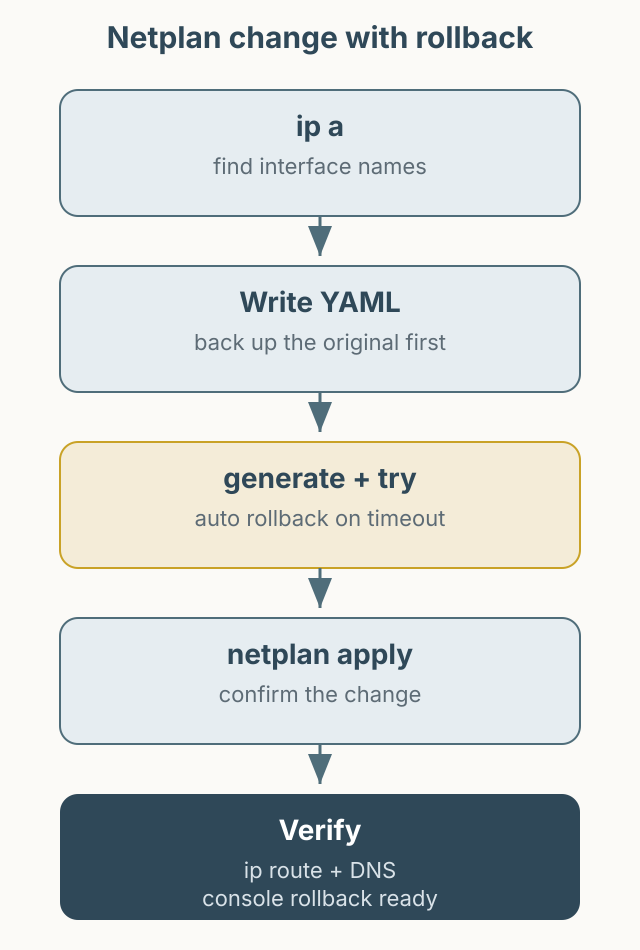

Ubuntu 서버의 네트워크를 Netplan으로 설정하는 방법을 정리합니다. 원격 서버에서 네트워크 설정을 잘못 적용하면 접속이 끊길 수 있으므로, `netplan apply` 전에 콘솔 접근 수단을 준비하고 `netplan try`로 먼저 검증하세요. 아래 인터페이스 이름, SSID, IP는 모두 예시입니다.



*그림 1. Netplan 설정을 적용하기 전에 인터페이스 확인과 복구 수단을 준비하는 순서.*

## 인터페이스 확인

```bash
ip a
```

출력에서 유선과 무선 인터페이스 이름을 확인합니다. 예를 들어 `enp3s0`은 유선, `wlp0s20f3`은 무선일 수 있지만, 이름은 하드웨어와 시스템마다 다릅니다. 아래 설정의 이름은 반드시 실제 값으로 바꿔야 합니다.

Netplan 설정 파일은 보통 `/etc/netplan/` 아래에 있습니다. 기존 파일을 덮어쓰기 전에 백업해 두세요.

```bash
sudo cp /etc/netplan/50-cloud-init.yaml /etc/netplan/50-cloud-init.yaml.bak
```

## 유선 DHCP

가장 단순한 설정입니다. 인터페이스 이름이 키가 되고, 그 아래에 `dhcp4`를 둡니다.

```yaml
network:
  version: 2
  renderer: networkd
  ethernets:
    enp3s0:
      dhcp4: true
```

## 무선 DHCP

무선은 `wifis` 아래에 인터페이스 이름을 두고, 그 아래에 `access-points`를 넣습니다. 예전 글처럼 `wlan0` 아래에 실제 인터페이스 이름을 넣는 구조는 올바르지 않습니다. networkd에서 `wifis`를 사용하려면 `wpasupplicant` 패키지가 필요하며, 서버 이미지에는 기본 설치되어 있지 않을 수 있습니다. 설치 여부는 `dpkg -l wpasupplicant`로 확인하고, 필요하면 `sudo apt install wpasupplicant`로 추가하세요. 자세한 내용은 [Netplan 문서](https://netplan.readthedocs.io/en/stable/netplan-yaml/)를 참고하세요.

```yaml
network:
  version: 2
  renderer: networkd
  wifis:
    wlp0s20f3:
      dhcp4: true
      access-points:
        "YOUR_SSID":
          password: "YOUR_WIFI_PASSWORD"
```

SSID와 비밀번호는 placeholder입니다. 설정 파일에 평문 비밀번호가 들어가므로 파일 권한을 제한하세요.

```bash
sudo chmod 600 /etc/netplan/50-cloud-init.yaml
```

## 고정 IP

고정 IP를 사용할 때는 `dhcp4: false`로 두고 주소, 기본 게이트웨이, DNS를 지정합니다. 아래 주소는 문서용 예시입니다.

```yaml
network:
  version: 2
  renderer: networkd
  ethernets:
    enp3s0:
      dhcp4: false
      addresses:
        - 192.0.2.10/24
      routes:
        - to: default
          via: 192.0.2.1
      nameservers:
        addresses:
          - 1.1.1.1
          - 9.9.9.9
```

고정 IP를 잘못 지정하면 SSH 접속이 끊길 수 있습니다. 같은 서브넷에서 사용하지 않는 주소인지, 게이트웨이가 맞는지 먼저 확인하세요.

## 적용 전 검증과 복구

문법을 먼저 검사합니다.

```bash
sudo netplan generate
sudo netplan try
```

`netplan try`는 일정 시간 안에 확인 응답이 없으면 이전 설정으로 되돌립니다. 원격 접속 중이라면 이 기능이 특히 유용합니다. 정상 동작을 확인한 뒤 적용합니다.

```bash
sudo netplan apply
```

적용 후에는 다음으로 상태를 확인합니다.

```bash
ip a
ip route
resolvectl status
ping -c 3 192.0.2.1
```

접속이 끊겼다면 서버 콘솔이나 물리 키보드로 접근해 백업 파일을 되돌리고 `netplan apply`를 다시 실행합니다. 클라우드 환경이라면 직렬 콘솔이나 복구 모드를 미리 확인해 두세요.

## 참고

`dhclient`를 직접 실행해 DHCP를 받는 방법도 있지만, Netplan이 관리하는 환경에서는 설정과 충돌할 수 있습니다. Netplan 설정을 사용하는 것이 일관적입니다. 이 글의 YAML은 구조를 설명하기 위한 예시이며, 실제 적용 전 `netplan generate`로 검증해야 합니다.
