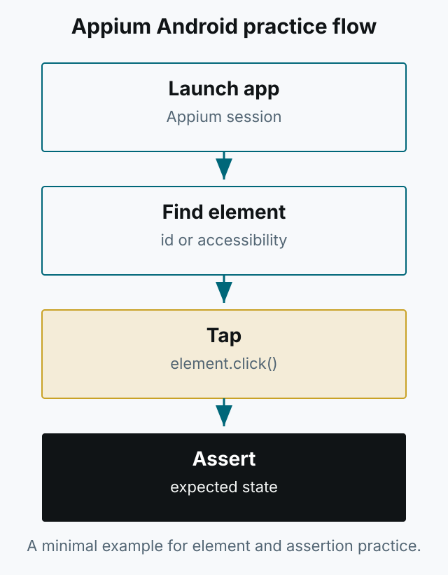

A minimal repository for starting Android automation with Appium. It demonstrates finding an element, tapping it, and asserting the expected state.

*Figure 1. The practice flow: launch the app, find an element, tap it, and assert.*

- Repository: [PracticeAutomationAppiumAndroid](https://github.com/kimkitae/PracticeAutomationAppiumAndroid)

See the repository README for installation and run instructions. At the time, I did not have an Apple developer account, so there was no iOS IPA sample. For iOS automation, use Appium's XCUITest driver. The project is old, so some settings may need adjustment for the current Appium version and Android SDK.
