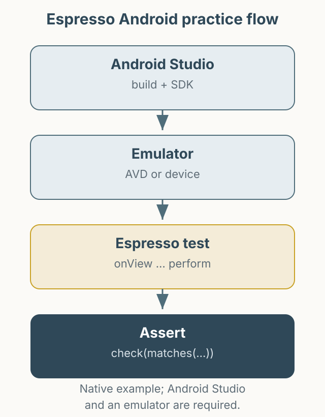

A minimal repository for practicing Android automation with Espresso. It covers the simplest flow: find a screen element, tap it, and verify the state.

*Figure 1. Build in Android Studio, run Espresso on an emulator, and assert the UI state.*

- Repository: [PracticeAutomationEspressoAndroid](https://github.com/kimkitae/PracticeAutomationEspressoAndroid)

The project assumes Android Studio, SDK Manager, and an emulator are already set up. See the README for details. There is no XCUITest sample because I did not have an Apple developer account at the time. The example reflects the versions at the time of writing; check dependency versions when building with current Gradle and Android SDK.
