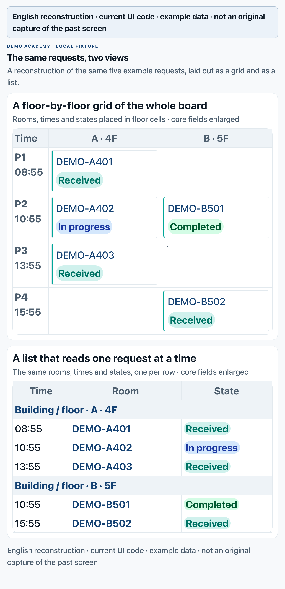

When I started my first AX project at a language academy in the Philippines, I was digitizing paper-based operations. The feature development looked like about two weeks of work. Move the paper requests onto screens and implement the documented business rules.

What actually took time was getting people to use the product. Two examples showed the difference most clearly. One was a cleaning-request screen, a question about how users read information. The other was class assignment, a question about how work gets decided.

Through this series, by AX I mean AI adoption and workflow transformation in operational work. It is not a universal formal standard; it is the practical work of changing how people do their jobs with software and AI. The ERP here is the academy's resource-planning system, the one that manages requests, assignments, and schedules.

## Before asking whether a grid or a list is better, look at what the user has to do first

Cleaning requests had been handled on paper. We computerized them. Staff who were not comfortable with computers struggled from the first step, which was finding the menu. I had assumed that level of operation would be obvious to everyone.

I first built the request list as a grid by building and floor. A clean overview of everything at once. The staff preferred a simple list, and understood that shape more easily.

*Reconstruction using the current UI code's structure and style. It uses the same five synthetic example requests and is not an original capture of the past screen.*

That preference taught me something about what a screen does. Collecting all the information in one place and finding the item a user must act on are two different tasks. A grid is good for comparing location and distribution, but the user has to read rows and columns to locate their own work. A list makes one request the unit of reading. Which one should be the default screen depends on what must be done first.

Here is a comparison I would use now when choosing a screen. It is not a reproduction of what staff said at the time.

| What must be done first on the screen | Layout to review first | What to check |
|---|---|---|
| Compare which floor or time has the most requests | Grid | Does the meaning of rows and columns read without explanation |
| Find one request's state and next action | List | Can the user find the target and reach the action button |
| See the whole picture and also handle individual items | One working default screen plus a separate overview | Does the user have to switch views just to do their job |

Next time I verify a screen like this, I will not stop at showing the design and asking whether people like it. I will give one example request and watch three things: can they find the entry without help, open that request, and check its state after processing. That separates screen preference from whether the task actually gets done.

## When the page stops, what the user needs to know

There was also a navigation error that once caused strong confusion among staff. What matters here is not only the wording of the error message. It is how far the user's request got processed.

Say someone pressed the submit button and the screen froze. The table below is not a recovery record of a real incident. It is a diagnostic table I would use when checking this kind of problem.

| Confirmed state | What the user can't be sure about | Next check or guidance |
|---|---|---|
| No request on the server | Should I press again | Report the failure and offer a retry path |
| Request saved, next screen did not open | Was it received | Look up the saved request and show it as received |
| Response dropped, save status unknown | Will retrying create a duplicate | Check state by request identifier, then decide retry |

If you mark an unknown-save state as failure right away, you push the user toward re-entering everything. If you mark it as success without confirming the save, the user believes the job finished. Completion criteria for a feature should include these intermediate states, not just the normal screen.

## Why I re-read the assignment rules for more than three months

Class assignment at the academy looked easy because rules existed. It stayed unfinished for more than three months, and reports kept coming in that teachers were not assigned. I repeatedly re-read the whole rule set while checking whether the assignment logic was wrong.

That is where I found an important difference. The system compared a student's subject and level with a teacher's. In practice, the scheduler also judged which teacher this particular student needed, beyond that comparison, and assigned directly.

So a result that satisfies the rules could still differ from what the academy expected. Until you check for that difference, every mismatch gets called an "assignment error," and they are not the same problem.

If I diagnosed this again, I would separate three types first.

| When the assignment result differs from what you expected | First thing to distinguish |
|---|---|
| A candidate matching the agreed conditions exists but was missed | Did the data and implementation apply the rules correctly |
| No candidate at all | Are the conditions conflicting, or is the actual resource insufficient |
| Rules produced a result but a different teacher was needed | Is there a path for the scheduler's per-student judgment |

The difference I found late was the third case. There was per-student judgment that the subject-and-level comparison did not capture. The first two cases and the third have different fixes. If there is no way to express the scheduler's choice, fixing the matching logic alone will never resolve that need.

## Agree on which rules to automate and where a person chooses

While aligning with how the academy worked, we standardized the assignment rule into one criterion. We also kept a separate manual path so that, under specific conditions, the scheduler can assign a particular teacher directly.

If I designed this again, I would review the rules in three groups. The categories and controls below are a design example for readers, not a list of features we actually implemented.

| Category | How to handle it |
|---|---|
| Constraints where violating them breaks operations | Check in both automatic and manual assignment. Example: an actual time overlap |
| Criteria for picking base candidates | Used in automatic matching, like subject and level |
| Parts the scheduler judges per student | Agree on the conditions and scope for manual selection |

Allowing manual assignment does not mean removing every constraint. You have to separate what can change from what must keep being checked. It is also better to keep the automatic result, the changed result, and the reason for the change as separate records. That is how you later tell whether the next problem is an implementation error, a request to change the rule, or an exception everyone agreed to.

For me, a project builder's job now includes those agreements and checks. A schedule that only hands the finished feature to its users could not contain all the work that real use required. In the next project, I will put two things into the initial completion criteria: task completion without help, and agreement on representative assignment cases.

---

If you are computerizing similar work or starting an AX adoption, tell me about it at [kimkitae@kflowlabs.com](mailto:kimkitae@kflowlabs.com).

K-FLOW LABS
