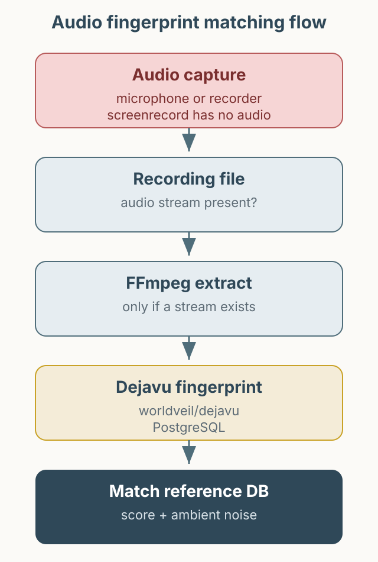

Whether a notification sound played is hard to confirm visually. The screen may show nothing, and the sound disappears when the test ends. This article describes using audio fingerprints to identify a notification sound in an automated check. First, a correction: an earlier version of this post introduced `appbaseio/dejavu` from Docker Hub as an audio fingerprint tool. That project is an Elasticsearch data viewer. Audio fingerprinting uses [`worldveil/dejavu`](https://github.com/worldveil/dejavu).



*Figure 1. Extract audio from a file that contains sound, fingerprint it, and compare it with known notification sounds.*

## What an audio fingerprint is

An audio fingerprint does not compare waveforms directly. It extracts prominent peaks in time and frequency, turns them into hashes, and stores those hashes in a database. Given a short recording, it counts how many hashes overlap with a reference. That is why it survives some compression and background noise.

`worldveil/dejavu` provides this process in Python. It can fingerprint a directory of reference audio and recognize a file or microphone input. Installation and run commands should be taken from the current README. The original environment ran PostgreSQL through docker-compose and used the `songs` and `fingerprints` tables.

```python
from dejavu import Dejavu

config = {
    "database": {"host": "127.0.0.1", "user": "dejavu", "password": "change-me", "database": "dejavu"},
    "database_type": "postgres",
}
djv = Dejavu(config)
djv.fingerprint_directory("reference_sounds/", [".mp3", ".wav"])
```

This is an abbreviated example of the shape, not a guarantee that every key is current. Check the library version and supported databases before running it.

## The recording must contain audio

The first thing to check is whether the recording contains sound at all. Android's `adb shell screenrecord` records video only and does not include audio. Appium's Android screen recording has the same limitation. To verify a notification sound, use a microphone or a separate recorder with audio enabled. The original post does not state exactly which capture path it used.

The verification flow is:

1. Run the scenario that triggers the notification with Appium.
2. Record the notification interval with a microphone or an audio-enabled recorder.
3. Retrieve the recording; for a device file, `adb pull` can be used.
4. Extract audio only if the file has an audio stream.
5. Recognize the extracted audio with `worldveil/dejavu` and check whether it matches the reference.

```bash
# Apply only to a file that contains an audio stream
ffmpeg -i notification.mp4 -vn -acodec pcm_s16le notification.wav
```

If using MoviePy, version 2.x imports `VideoFileClip` from `moviepy`; the 1.x `moviepy.editor` path was removed in 2.x. See the [MoviePy migration guide](https://zulko.github.io/moviepy/getting_started/updating_to_v2.html). The primary example here uses FFmpeg.

A recording that includes audio also contains ambient noise and other system sounds. A practical approach is to fingerprint the reference under several conditions and treat a match score above a threshold as success. The threshold depends on device, microphone position, volume, and OS audio processing, so a single hard-coded value is not advisable.

## Observation and limits

In one home environment with a TV on and family members talking, the notification still matched. That is an observation in a specific environment, not a performance guarantee. Results vary with the recording path, microphone, volume, and audio processing.

The method also tells you that the sound occurred, not that the notification reached the user correctly. It should be combined with UI checks. In production, you would need reference audio management, threshold monitoring, and a policy for retaining failed recordings.

## Summary

Audio fingerprints are a useful supporting signal for sounds that are hard to see. First check that the recording actually contains audio; extraction cannot apply to a file with no sound stream. When choosing a tool, do not confuse projects with similar names. Start with one short file using the official examples before adding it to a suite.
