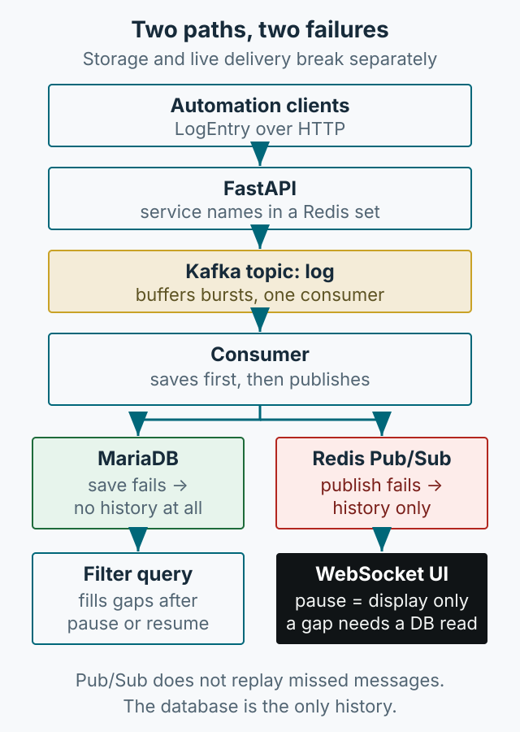

When the number of automation tools grows, finding out where a failure happened becomes a bottleneck. Full observability platforms such as New Relic, Datadog, or Grafana exist, but attaching one just to read a single log line can be excessive. This article summarizes a small LogViewer built on an existing API server with Kafka and Redis. The point is not the component list but that **storage and live delivery fail differently**.



*Figure 1. The storage path and the live path. The same log crosses both, so each must be checked separately when it goes missing.*

## Why Kafka

The first idea was for the API server to write logs directly to the database, because growing volume could slow request handling. So the API publishes to a Kafka topic, and a separate consumer handles persistence and live delivery.

Kafka was chosen for scalability and bottleneck concerns, and because it was a technology I wanted to apply here. The original does not show the consumer's offset commit policy. This article therefore cannot claim when offsets were committed or whether failed messages were reprocessed.

Current advice is separate. If volume is small and there is one consumer, Kafka costs more to operate: brokers, topics, partitions, consumer groups, and the work of determining how far processing got after a failure. It earns its place when several consumers need the stream or when spikes must be buffered.

## Two paths

- **Storage path**: API → Kafka → consumer → MariaDB. Produces history that can be queried later.
- **Live path**: consumer → Redis `log` channel → WebSocket → browser. Updates the screen you are watching now.

Redis Pub/Sub delivers only to currently subscribed clients. The Redis documentation states that Pub/Sub does not persist messages and that a client cannot receive messages published while it was not subscribed ([Redis Pub/Sub docs](https://redis.io/docs/latest/develop/pubsub/)). The live path therefore **does not replay missed deliveries**. Missed logs must be read back from the database.

The original consumer writes to the database, then publishes. This is a shortened example of the order, not a verbatim copy of the original source:

```python
async for message in consumer:
    data = json.loads(message.value.decode("utf-8"))
    await save_log(data)
    await redis.publish("log", json.dumps(data))
```

Order matters. If the database write fails, the publish below it never runs. The log appears neither in history nor on screen. If the publish fails instead, the log is stored but invisible live. The same symptom — “the log is missing” — has opposite causes.

## Pausing the screen does not stop collection

The original UI adds incoming WebSocket logs to the screen. When `isPaused` is true, it only skips display:

```javascript
if (!isPaused) {
    // add only logs that pass the level, service, and tag filters
    addLogs([data]);
}
```

The original calls this “pause live updates.” It stops the screen, not server collection or database writes. Resuming or changing the tag filter calls `fetchLogsForService`, which reads the service's logs from the database again (original web UI code, `source` lines 328-368). A comment in the source says the database is read “only on refresh,” but the code also reads it on resume and filter changes.

That distinction matters in operation. If a user stays paused for a long time, those logs are absent from the screen. On resume the database fills them in, so they may not look lost. By contrast, a gap where the database write failed stays empty even after resume. **Whether logs appear after pause and resume** is the first check that separates the storage path from the live path.

## Diagnosing which path failed

| Failure point | Symptom | Evidence to check | Next step |
|---|---|---|---|
| API → Kafka send | The original API may report success despite a send failure | Producer exception log, actual topic receipt | Propagate failure to the caller and compare the response with delivery evidence. |
| Consumer database write | Missing live and in history | Consumer exception log, row counts | Alert on the failure and check whether reprocessing is possible. |
| Redis publish | In the database, not on screen | Compare a database query with the screen | Check whether refresh or filtering reads it back. |
| Client disconnect | Logs missing while disconnected | WebSocket close code, reconnect log | Confirm the UI re-reads the database after reconnect. |
| Duplicate delivery | The same log twice | Message key, duplicate rows | Make consumption idempotent and enforce a key. |

The original producer's `send` catches exceptions, logs them, and does not rethrow them. An API success response therefore does not establish successful Kafka delivery. Conversely, the consumer example has no exception handler inside the loop, so a database error can escape it. The source does not show task supervision or restart behavior; automatic recovery is unknown.

For a log that exists in the database but not on screen, inspect the live path first. If it is absent from the database too, check actual topic receipt and consumer exceptions rather than trusting the producer's API success response. This separates different failures behind the same symptom.

Duplicates can occur on both paths. The original builds a message key as `{service_name}_{timestamp}`, but a reprocessed message can still be stored twice. The source shows no idempotency handling or unique constraint. If rebuilding, enforce uniqueness on the key and tolerate reprocessing. Do not claim exactly-once delivery.

## Simpler alternatives

This structure can be overkill.

- **SSE**: one-way server-to-client delivery, simpler through proxies and on reconnect. If the screen sends nothing back, it is easier than WebSocket.
- **WebSocket**: consider it when the client must send business events back to the server. The original UI's ping/pong is connection bookkeeping, so it alone does not make WebSocket necessary over SSE.
- **Without Kafka**: with low volume and one consumer, the API can write to the database directly and notify over SSE or WebSocket.
- **When replay is needed**: consider Redis Streams or database polling. Pub/Sub does not replay.

These are current design judgments, not a record of migrating the original system.

## What to decide first in operation

The first decision is what not to log. Verification codes, tokens, and order details should be masked at the client before they reach the viewer. A retention period per service belongs in the same decision.

Keep the UI small: service selection, tag and level filters, pause, pagination, and connection status are enough. A useful test is whether a reader can tell why a log is missing. Showing reconnection state, reporting a failed database query, and noting that collection continues while paused all follow from that.

## Summary

This is not a full observability platform, only a way to check logs from small internal tools quickly. Separating the storage path from the live path, knowing that pause only stops display, and defining evidence per failure point is enough until volume grows. The code here is an abbreviated explanation of the implementation, not a version tested against current library releases.
