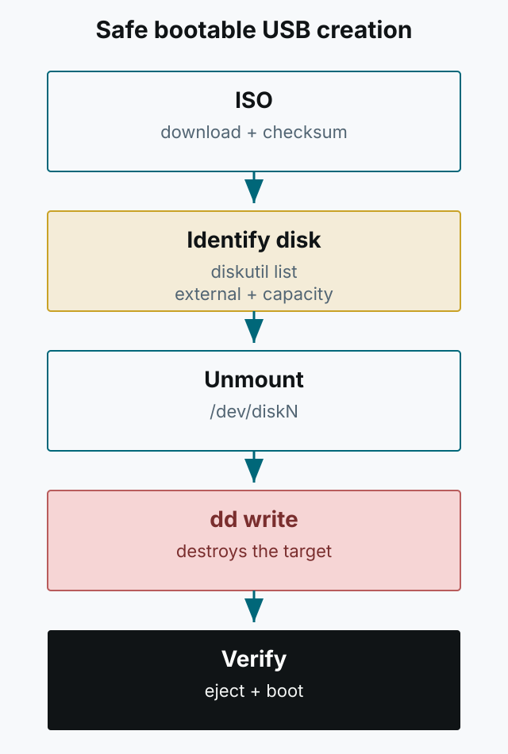

This is the process I used to create a bootable USB while installing Ubuntu on an LG Gram laptop. `dd` destroys the target disk if you point it at the wrong device. Confirm that the target is really the USB before running any command below.



*Figure 1. A safe order: verify the disk and unmount it before writing.*

## What you need

- Ubuntu Desktop or Server ISO ([download](https://ubuntu.com/download))
- A USB drive of at least 4GB
- `Disk Utility`, `diskutil`, and `dd` on macOS

## Format and convert the ISO

Format the USB as `MS-DOS(FAT32)` in Disk Utility. Then convert the ISO to UDRW in the terminal.

```bash
hdiutil convert -format UDRW -o ubuntu.img ubuntu.iso
mv ubuntu.img.dmg ubuntu.img
```

`hdiutil convert` appends `.dmg`, so rename the output to the name used by `dd`. Keep the original ISO as a backup.

## Identify the target disk

This is the most important step. Use `diskutil list` to see all disks and the USB identifier.

```bash
diskutil list
```

A USB drive is usually marked `external, physical`. Check the capacity and name together. Never choose an internal disk such as `/dev/disk0`. The `/dev/diskN` below must be replaced with the real value; do not copy it literally.

```bash
diskutil unmountDisk /dev/diskN
```

If unmounting fails with `Resource busy`, find out which process is using the disk. If necessary, use `diskutil unmountDisk force /dev/diskN`; if it still fails, rebooting is safer.

## Write with dd

Confirm once more that the target is the USB, then write.

```bash
sudo dd if=./ubuntu.img of=/dev/rdiskN bs=4m
```

On macOS, the raw device `/dev/rdiskN` can be faster. Adjust `bs` for your environment. Wait until writing finishes and do not unplug the USB in the middle.

## Finish and verify

```bash
diskutil eject /dev/diskN
```

`diskutil list` should show the changed partition layout. If possible, boot the target laptop and confirm the installer starts. If it does not, check the ISO integrity, the USB drive, and secure boot settings in that order.

This article does not assume a disk number. Never run the `dd` command without verifying the target, and never use it on a disk that contains data you need.
