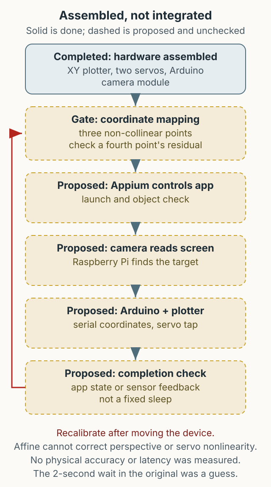

When a service has several payment methods, every deployment requires checking all of them from order to payment completion. Each payment provider encrypts its virtual keypad and shuffles the digits, and protected screen areas appear black in ordinary captures. This article is an interim record of an experiment that went outside software to reduce that repetition. It is not a finished product: the hardware was assembled, but the software integration was not completed.



*Figure 1. The flow I wanted to build. I assembled the hardware, but did not finish the software integration.*

## Why hardware

The test framework also consumed a lot of CPU and memory. I considered moving some work to separate hardware and coordinating it through an API.

Mobile automation usually finds elements through the accessibility tree or screen capture. On heavily protected screens, such as payment flows, the capture may be empty or the virtual keypad layout may change on every visit. So the idea shifted from reading the screen to reproducing a physical press.

## The proposed flow

The setup used an off-the-shelf XY plotter from AliExpress, with an Arduino and room for customization, plus a camera module connected to an Arduino or Raspberry Pi. The intended flow was:

1. Appium launches the app and checks whether an object exists.
2. The Raspberry Pi camera captures the screen and identifies the object.
3. The coordinates are sent over serial to the Arduino robot arm.
4. Two servos move the X and Y axes to press the target.
5. Appium checks the result of the click.

That flow survives as a design and code fragments, but the whole path was not verified running on a real device.

```python
# Coordinate relay from the original example
from flask import Flask, request, jsonify

app = Flask(__name__)

@app.post("/click")
def click():
    data = request.get_json(force=True)
    x, y = int(data["x"]), int(data["y"])
    # ser.write(f"{x},{y}\n".encode())
    return jsonify({"status": "accepted", "x": x, "y": y})
```

The original exposed this server on `0.0.0.0` without authentication. If publishing it today, bind it to an internal interface and add caller authentication and request limits first.

## Arduino and servos

The Arduino receives coordinates over serial and moves the servos. The original code attaches two servos to the X and Y axes, moves to the coordinates, performs the click, and returns to a reference position.

```cpp
#include <Servo.h>
Servo servoX;
Servo servoY;

void setup() {
  Serial.begin(9600);
  servoX.attach(9);
  servoY.attach(10);
}
```

Servo angles do not map one-to-one to screen coordinates. If I rebuilt it today, I would design a calibration procedure per device size and screen position first, and assume that moving the device requires recalibration. Mechanical play, distance from the screen, lighting, and camera resolution are additional physical variables to tune.

## Where it stopped

At the time, I had assembled the hardware but had not finished the software integration. I wanted to complete it when I had time, with one plotter per phone running BDD-style scenarios continuously. That was the goal, rather than a completed deployment.

If I rebuilt it today, I would decide these first:

- Bind the coordinate API to an internal interface and require authentication.
- Replace the fixed wait with a completion signal or sensor feedback.
- Calculate the space and management cost of one plotter per device, plus recalibration cost.
- Reproduce physical actions only in an allowed test environment rather than bypassing protected screens.

The code here explains the original experiment; it is not production-ready.
