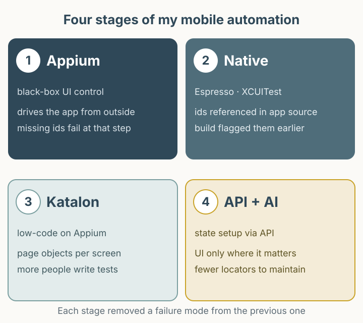

When mobile automation fails, classify the failure before changing tools. A broken app, an unavailable device, and data left by a previous run need different fixes. Drawing on my 2024 account of moving between Appium, native frameworks, and Katalon, this article sets out the criteria I would use to design those tests today. The diagnostic table and worked order example are new proposals, not recorded results from that earlier system.

*Figure 1. A proposed separation of state preparation and UI verification. Evidence from each step helps narrow down the failure.*

## Four decisions that changed the tool

I first met Appium in 2014. It worked through code and a CLI rather than a GUI recorder, which stood out. With very little Korean-language material available, it took a long time to make even one Android device reliable. Later I ran several devices in parallel, collected results, and attached the process to releases.

At a commerce QA team in 2018, I used Appium across Android and iOS and connected builds and tests through Jenkins. Then failures from missing or changed resource IDs became routine. We moved to Espresso on Android and XCUITest on iOS, and later to Katalon with page objects to widen who could write tests. By 2024, the original post described preparing state through APIs, using the UI only where confirmation mattered, and experimenting with GPT-assisted selector repair.

All four decisions answered the same question: **who can explain this failure, when, and with what evidence?**

## Decide what to verify where

Splitting the target of verification before choosing a tool makes the choice simple.

| What you verify | In the UI | In the API | Why |
|---|---|---|---|
| The value is actually displayed | primary check | Impossible | Rendering, formatting, and accessibility exist only in the UI. |
| Calculation, permission, state transition | Slow and unstable | recommended primary check | The server holds the final decision and the failure point is narrow. |
| One user action actually works | primary check | Impossible | Tapping, typing, and scrolling are sometimes the thing under test. |
| The starting state for the next test | Avoid | Recommended | Creating data through the UI mixes UI and data failures. |

For example, one scenario can become “one state-setup call plus one UI check.” That is an illustrative allocation, not a measured saving. The original post's claim that API-assisted testing reduced resource-ID dependence has the same cause. The tradeoff: data created through an API may bypass the path a user takes, so the route by which a user reaches that state still needs its own scenario. An offline or client-only app may have no server API at all, so the API column can be empty; the table splits responsibility rather than assuming every app has the same layers.

Framework choice follows the same axes. Appium reads the accessibility tree from outside the app, so the author need not know the source and can choose any language. Its selectors are runtime strings, and the hierarchy depends on app implementation. Espresso runs inside the app process, while XCUITest drives the app through the accessibility layer from a separate test runner. Both require managing the app build together with the test target, which couples them to the build pipeline and limits authoring to people with access. That coupling is not always a benefit. Source access and build integration are one axis; when a selector is checked is another. A test target in the same module is integrated into the build, but whether the selector is a resource reference or a string still decides whether a missing identifier breaks compilation or fails at run time.

## Native does not always mean compile-time checks

The original post said that after moving to native frameworks, “missing or changed resource IDs could be checked during the build without running tests.” That experience was real, but the reason differs by platform.

On Android, `R.id.checkout_button` is an integer constant generated at build time. If a test references it, removing the ID breaks compilation. On iOS, XCUITest queries `app.buttons["checkoutButton"]` as a **runtime string**. Deleting that identifier in the app leaves the test compiling; it fails at run time when the element is not found. “Native means compile-time checks” is true for Android resource references and false for iOS accessibility strings.

What the build actually catches also depends on configuration: whether the test target lives in the same module and uses resource references, whether it uses string selectors, and whether lint rules are enabled. The accurate statement is that the reference style decides when the problem surfaces, not that native frameworks remove selector maintenance.

There is also a correction about Appium. Appium fails at the step where an element is not found; it is not a tool that withholds failures until every test finishes. The original only records that feedback was delayed and does not establish the cause. Aggregating results from several devices into one report after the suite ended could delay the first failure becoming visible, but that is a possible pipeline issue, not a confirmed historical cause. Without that distinction, switching tools may keep the same delay.

The switch contributed to shortening the release cadence from once every two weeks to once a week. Release cadence also depends on team structure, release policy, and build time, so it would be wrong to credit the framework change alone.

## A worked example: state, one UI interaction, evidence

The table below is not executable code. It splits the proposed structure into input, expectation, observation, evidence, and cleanup. It is not an internal endpoint or a real discount rule, and the environment was not verified. The point is the division of labor.

| Step | Input and action | Expectation | Evidence | On failure |
|---|---|---|---|---|
| 1. Prepare | Create an order without a coupon (one item, 10,000) | `order_id` and a create response with `payable_total` 10,000 | Request and response JSON, `order_id` | Order creation is an environment issue, not a UI issue. |
| 2. UI action | Open the cart and press the 10% coupon button once | The screen total is 9,000 | Before and after screenshots | A tap failure is a locator or screen-state problem; state preparation already succeeded. |
| 3. Check | Compare the screen total with a second API read | Both are 9,000 | Screenshot and the second API response | A different value is a calculation or display problem. |
| 4. Clean up | Delete the order regardless of success or failure | Delete response confirms the order is gone | `order_id`, deletion time, deletion failure log | A failed cleanup becomes the next run's data contamination, so log it. |

The expected total comes from the coupon rule (10,000 × 0.9 = 9,000), not from the pre-coupon `payable_total`. Using the pre-coupon value as the expectation and comparing it with the post-coupon screen always mismatches. Put cleanup on a guaranteed path such as `try/finally`.

Collect evidence on passing runs too. Keeping the order ID and expected value lets the next run compare when stale data causes a failure. A screenshot alone loses what the expectation was.

## A diagnostic table with four failure classes

Fixing the order in which you read a failure speeds up the investigation.

| Class | Typical symptom | Look at first | Next step |
|---|---|---|---|
| Environment/infra | Several tests fail at the same step, session creation fails | `adb devices`, driver and OS versions, session capabilities, node logs | Fix the environment; do not record it as an app failure. |
| Locator/rendering | Element missing on one screen only, empty hierarchy | Page source or accessibility snapshot, screenshot, loading/animation state | Check wait conditions and identifiers. |
| Data state | Element present but the value matches a previous run | Request payload, lookup API response, leftover account state | Isolate state preparation and add cleanup. |
| Business rule | UI looks fine but the result value is wrong | Server logs, calculation basis, specification | Record it as a product defect with reproduction steps. |

The value of this table is fewer “passes on retry” tests. If you do not know whether a retried failure was environmental or data contamination, the same cause accumulates. Logging the failure class along with retry counts makes the cause visible.

## How automatic selector repair produces a false pass

The 2024 post described GPT-assisted selector repair positively. My current view is different. Automatic repair can propose a likely cause, but treating its result as a pass lets **a failed test pass for a different reason**.

Suppose a screen has two “Confirm” buttons and the intended target is the payment confirmation. After the selector breaks, automatic repair picks the first matching “Confirm” button. The test clicks successfully and continues. If the final check is only “no exception was raised,” the run is green. The user never paid, but the test succeeded.

Three ways to prevent it:

1. **Fail when ambiguous.** If more than one candidate matches, do not auto-select; fail.
2. **Record the change.** Log the old selector, the new selector, and the rationale, and require human review.
3. **Assert the business outcome.** Verify a completed payment state, not the presence of an element.

This article does not measure automatic repair accuracy or pass rates. Without measurements from a specific environment, there is no basis for claiming a large benefit. Image-based vision sits in the same place: a supporting signal when screen reading fails, not the standard of proof.

## Where I stand now

Before changing tools, check three things: can state preparation move to an API, are failures classified and logged, and are the UI checkpoints narrowed to one or two points. With those in place, Appium and native frameworks can explain the same failure equally quickly.

The 2024 assessment and the current one differ on trust in automatic repair. That difference came from writing this retrospective. The original does not record an actual false pass caused by automatic repair in production.
