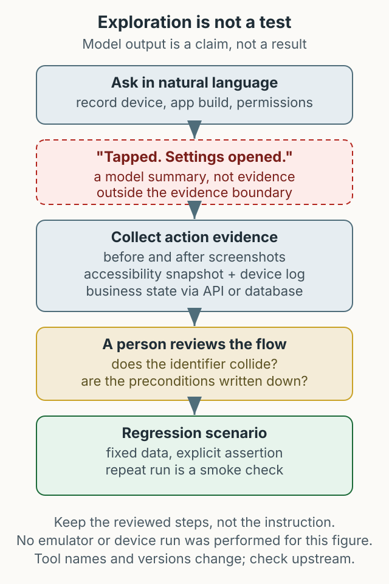

MCP (Model Context Protocol) is a protocol that lets AI tools call external systems and tools. This article walks through connecting an MCP-based mobile automation server to Cursor and Claude Desktop and checking it against an iOS simulator and an Android emulator. The ability to run tests in natural language is interesting, but stability and reproducibility are still being verified.



*Figure 1. Cursor or Claude Desktop exchanges accessibility information and actions with devices through an MCP server.*

## What MCP does

An MCP server exposes a list of tools to an AI client. When the client calls a tool, the server performs the work. For mobile automation, the tools read the accessibility snapshot, list elements, and perform taps, text input, and screenshots. The advantage is that you do not manage sessions and selectors the way you do with Appium.

The risk is assuming it works the same way in every app. Screens without accessibility labels or with heavy WebView usage can be hard to identify, and coordinate taps are sensitive to resolution. For regression tests that need reproducibility, it is safer to treat this as a supporting tool for now.

## Prerequisites

- **Node.js**: needed to run the server; LTS is recommended.
- **Xcode Command Line Tools**: iOS simulator and build tools.
- **Android Studio + Platform Tools**: `adb` and emulators.
- **AI client**: Cursor or Claude Desktop.

```bash
node --version
xcode-select -p
adb version
```

Package names and CLI options can change. Before installing, check the [Mobile MCP repository](https://github.com/mobile-next/mobile-mcp) and the npm package page for current instructions, then record the version actually resolved in your environment. The configuration below uses `@latest`; because that value changes over time, record the resolved version separately if reproducibility matters. The MCP specification itself is documented at [modelcontextprotocol.io](https://modelcontextprotocol.io/).

## Cursor configuration

Cursor reads MCP servers from `mcp.json` in its user configuration directory.

```bash
mkdir -p ~/.cursor
```

```json
{
  "mcpServers": {
    "mobile-mcp": {
      "command": "npx",
      "args": ["-y", "@mobilenext/mobile-mcp@latest"]
    }
  }
}
```

Restart Cursor completely after saving. If the server does not appear, run the command in a terminal to see the error.

## Claude Desktop configuration

On macOS, the file is `~/Library/Application Support/Claude/claude_desktop_config.json`. Add the server in the same shape.

```json
{
  "mcpServers": {
    "mobile-mcp": {
      "command": "npx",
      "args": ["-y", "@mobilenext/mobile-mcp@latest"]
    }
  }
}
```

Restart Claude Desktop after saving. If you already have configuration, merge the `mcpServers` object and check the JSON syntax.

## Connecting devices

List and boot an iOS simulator:

```bash
xcrun simctl list devices
xcrun simctl boot "iPhone 16"
open -a Simulator
```

Start an Android emulator:

```bash
emulator -list-avds
emulator -avd Pixel_7_API_34
adb devices
```

For physical devices, enable trust on iOS and USB debugging on Android. Use only test devices that your organization allows.

## A practical check

Once connected, you can ask the AI client:

```text
List the available mobile devices and running simulators.
List the UI elements on the current screen, then open Settings > General.
```

Compare the device names and elements in the response with the actual screen. Before trusting automation, reproduce the same action manually and inspect what information is left when it fails. Natural-language commands are convenient, but “the same command always produces the same result” is a separate question.

## Limits and summary

This approach is useful for exploratory testing, quick screen checks, and repetitive input. It is not yet sufficient for security-sensitive flows such as payment and authentication, or for precise regression checks. If you adopt it, build tool-call logs, failure screenshots, and reproducible scenarios first, and divide responsibilities with Appium or native tests. The package name and commands here are examples from the time of writing; check the current documentation before installing.
