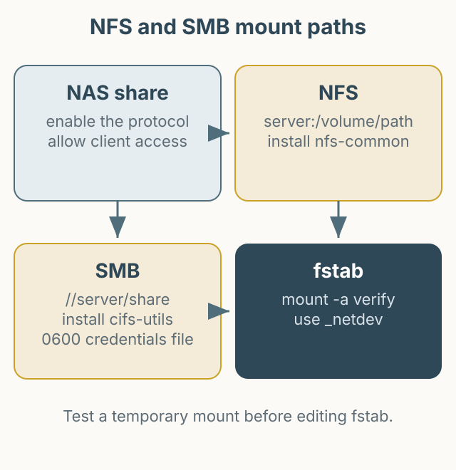

This article explains how to mount NAS shared folders on an Ubuntu server. NFS and SMB are configured differently, so choose one protocol and follow only that section. The IPs and paths below are examples and must be replaced with your own values.



*Figure 1. Configure NFS or SMB, verify with a temporary mount, then add automatic mounting.*

## NFS

Enable the NFS service on the NAS and add the client server's IP to the shared folder's NFS permissions. Prefer a specific IP and avoid giving write access to everyone.

Ubuntu needs `nfs-common`.

```bash
sudo apt update
sudo apt install nfs-common
sudo mkdir -p /mnt/nas-nfs
```

Test with a temporary mount first. `192.0.2.10` is a documentation address.

```bash
sudo mount -t nfs 192.0.2.10:/volume1/shared /mnt/nas-nfs
findmnt /mnt/nas-nfs
```

After confirming it works, add it to `/etc/fstab`.

```fstab
192.0.2.10:/volume1/shared /mnt/nas-nfs nfs defaults,_netdev 0 0
```

`_netdev` tells the system to mount after the network is ready. Run `sudo mount -a` to validate the entry, and fix the file immediately if it reports an error.

## SMB

SMB needs `cifs-utils`.

```bash
sudo apt update
sudo apt install cifs-utils
sudo mkdir -p /mnt/nas-smb
```

Test a temporary mount first. Writing a password directly in the command line can leave it in shell history and the process list, so use a credentials file.

```bash
sudo mkdir -p /etc/samba
sudo install -m 600 /dev/null /etc/samba/credentials-nas
sudo tee /etc/samba/credentials-nas >/dev/null <<'EOF'
username=your_user
password=your_password
EOF
```

The file should be owned by root with mode `0600`.

```bash
sudo chown root:root /etc/samba/credentials-nas
sudo chmod 600 /etc/samba/credentials-nas
sudo mount -t cifs //192.0.2.10/shared /mnt/nas-smb \
  -o credentials=/etc/samba/credentials-nas,iocharset=utf8,uid=1000,gid=1000,file_mode=0775,dir_mode=0775
```

An SMB path uses `//server/share`. It is not the NFS form `server:/volume/path`; do not mix them. Replace `uid` and `gid` with the local user's values.

Add the automatic mount to `/etc/fstab`.

```fstab
//192.0.2.10/shared /mnt/nas-smb cifs credentials=/etc/samba/credentials-nas,iocharset=utf8,uid=1000,gid=1000,file_mode=0775,dir_mode=0775,_netdev 0 0
```

Putting `password=` directly in fstab exposes it to anyone who can read the file. That is why the credentials file is preferred. Validate with `mount -a`, then reboot to confirm automatic mounting.

## Unmounting and troubleshooting

```bash
sudo umount /mnt/nas-nfs
sudo umount /mnt/nas-smb
```

If a mount fails, check:

- Is the protocol service enabled on the NAS?
- Is the client IP allowed on the NAS?
- Does `showmount -e <NAS_IP>` (NFS) or `smbclient -L //<NAS_IP>` (SMB) list the share?
- Are the required ports open in the firewall?
- Is the credentials file mode `0600`?

If you use only one protocol, do not add the other section's configuration. When using both, keep mount points and fstab entries clearly separated.
