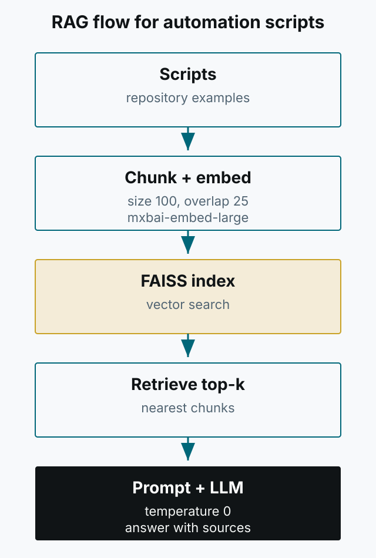

Automation code changes often. Function names and parameters drift, and finding an old example can mean digging through a repository. This article summarizes an attempt to reduce that search cost with a local LLM and RAG (Retrieval-Augmented Generation). The important premise is that RAG does not retrain the model. It retrieves context and places it in the prompt.



*Figure 1. The basic RAG loop. The key work is retrieval and prompt construction, not model training.*

## Why RAG instead of fine-tuning

We considered fine-tuning first. But in an environment where function signatures and examples change often, rebuilding training data cost more than it saved. RAG only needs a fresh index of the repository to reference current code.

The original records 130GB of memory use when trying LoRA training with Mlx-lm. That number should not be presented as a universal requirement; it depends on hardware and settings. Today I would start with RAG unless there is a clear need for fine-tuning.

## Local models and hardware

To avoid sending data outside, we ran locally. An Apple Silicon Mac has a GPU and can use Metal acceleration; a runtime such as Ollama can take advantage of it. The older claim that “Macs have no GPU” is inaccurate. Memory requirements still grow with model size and context length, so start with a smaller model and scale up.

Model names change quickly. `Llama 3` and `mxbai-embed-large` were examples at the time. Check the current model list for your runtime.

## Indexing: chunks and embeddings

Split scripts into chunks, embed each chunk, and store the vectors in an index such as FAISS. Chunk size and overlap strongly affect retrieval quality. Too large and unrelated content dilutes the match; too small and the function context disappears.

```python
# Abbreviated shape, not a complete implementation
chunks = split_text(script, size=100, overlap=25)
vectors = [embed(chunk) for chunk in chunks]
index.add(np.array(vectors, dtype=np.float32))
```

The source code logs a failed embedding, checks that all vector dimensions match, and then builds the FAISS index. If building this today, also record how many chunks failed and how many vectors entered the index, so an incomplete index does not pass silently.

## Retrieval and prompting

When a question arrives, embed it with the same model, retrieve the top-k nearest chunks, and pass them to the LLM with a system prompt such as: “Do not use information outside the context; include the relevant function and parameters.” Setting temperature near zero favors grounded answers over creative ones, but temperature zero does not guarantee factual correctness. Verify that any generated function actually exists in the repository.

```python
context = "\n\n".join(results[:3])
prompt = f"Context:\n{context}\n\nQuestion: {query}"
answer = llm.generate(prompt, temperature=0.0)
```

## Data and retrieval quality

The original concludes that data matters more than the model: scripts without comments or with vague names are hard for an LLM to find. Search results included the file path and a preview, and the Slackbot also showed the results the model used. A reader should be able to see the answer and its evidence together.

Connecting it to Slackbot let team members ask questions and see both the answer and the retrieved results. Keeping the scope to retrieval and suggestion, without automatically executing generated answers, is still a sensible boundary today. The code here is a sketch of the architecture, not runnable code for current libraries. Start with one small repository and measure retrieval quality and failure logs before deploying it.
