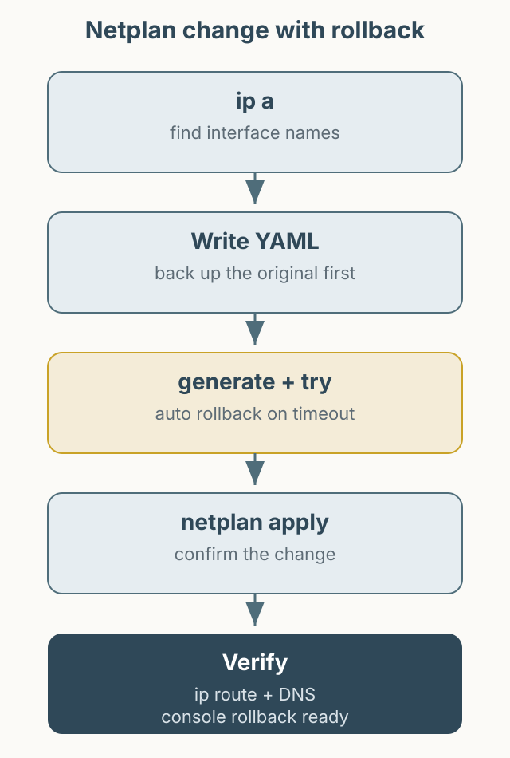

This article explains how to configure Ubuntu networking with Netplan. Applying a bad network change to a remote server can cut off access, so prepare console access and test with `netplan try` before `netplan apply`. Interface names, SSIDs, and IPs below are examples.



*Figure 1. Confirm the interface and prepare recovery before applying a Netplan change.*

## Find the interface

```bash
ip a
```

Identify the wired and wireless interface names. `enp3s0` may be wired and `wlp0s20f3` wireless, but names vary by hardware and system. Replace the names in the configuration with the real values.

Netplan files are usually under `/etc/netplan/`. Back up the existing file before editing.

```bash
sudo cp /etc/netplan/50-cloud-init.yaml /etc/netplan/50-cloud-init.yaml.bak
```

## Wired DHCP

The simplest configuration uses the interface name as a key and `dhcp4` beneath it.

```yaml
network:
  version: 2
  renderer: networkd
  ethernets:
    enp3s0:
      dhcp4: true
```

## Wireless DHCP

For wireless, the interface name goes under `wifis`, and `access-points` goes beneath the interface. The old structure that placed the interface name under a fake `wlan0` key is invalid. Using `wifis` with networkd requires the `wpasupplicant` package, which may not be installed on a server image. Check with `dpkg -l wpasupplicant` and install it with `sudo apt install wpasupplicant` if needed. See the [Netplan documentation](https://netplan.readthedocs.io/en/stable/netplan-yaml/).

```yaml
network:
  version: 2
  renderer: networkd
  wifis:
    wlp0s20f3:
      dhcp4: true
      access-points:
        "YOUR_SSID":
          password: "YOUR_WIFI_PASSWORD"
```

The SSID and password are placeholders. Because the file contains a plaintext password, restrict its permissions.

```bash
sudo chmod 600 /etc/netplan/50-cloud-init.yaml
```

## Static IP

For a static address, set `dhcp4: false` and provide the address, default gateway, and DNS. The addresses below are documentation examples.

```yaml
network:
  version: 2
  renderer: networkd
  ethernets:
    enp3s0:
      dhcp4: false
      addresses:
        - 192.0.2.10/24
      routes:
        - to: default
          via: 192.0.2.1
      nameservers:
        addresses:
          - 1.1.1.1
          - 9.9.9.9
```

A wrong static address can cut off SSH. Confirm that the address is unused on the same subnet and that the gateway is correct.

## Validate and recover

Check the syntax first.

```bash
sudo netplan generate
sudo netplan try
```

`netplan try` reverts the configuration if you do not confirm within a timeout. That is especially useful during a remote session. After confirming it works, apply it.

```bash
sudo netplan apply
```

Verify the state:

```bash
ip a
ip route
resolvectl status
ping -c 3 192.0.2.1
```

If access drops, use the server console or a physical keyboard, restore the backup, and run `netplan apply` again. In a cloud environment, confirm serial console or recovery-mode access beforehand.

## Note

Running `dhclient` directly can also obtain a lease, but it may conflict with Netplan-managed configuration. Using the Netplan configuration is more consistent. The YAML here is an example of the structure; validate it with `netplan generate` before applying.
