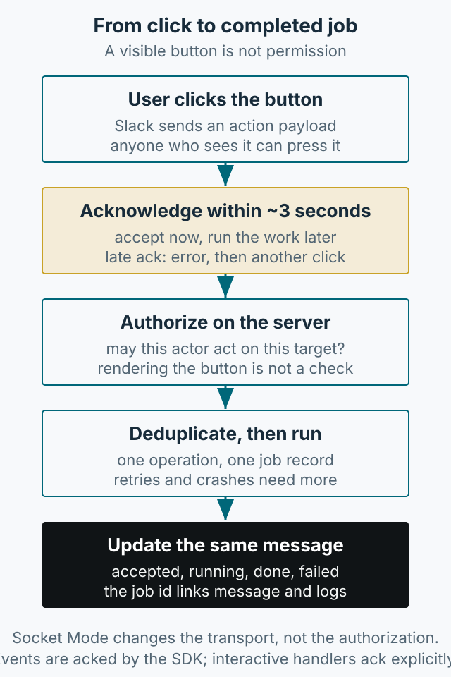

Slackbots are effective at reducing repetitive work, but the initial setup has many steps and can feel intimidating. This article walks through app creation to a first running bot. Never put production tokens in source code; use environment variables or a secret manager.



*Figure 1. The initial setup sequence. Bot tokens and app-level tokens serve different purposes.*

## Why a Slackbot

Testing work involves repeated data creation, account resets, test runs, and result checks. Doing them manually costs time, and low-frequency procedures are easy to forget. Answering the same “how do I do this?” question for other teams adds more overhead.

A Slackbot can present a Modal View, collect the necessary values safely, and run the action. It can also start tests from a command and summarize results in a channel. The goal is not to remove human judgment but to reduce the time spent finding and repeating procedures.

## Creating the app and tokens

1. Open [Slack API](https://api.slack.com/apps) and choose `Create New App`.
2. Use `From scratch`, or `From a manifest` if you have a manifest.
3. Create an `App-Level Token` and add the `connections:write` scope. It starts with `xapp-`.
4. Install the app to the workspace and copy the `Bot Token`, which starts with `xoxb-`. The example needs `app_mentions:read` and `chat:write` on the bot token to receive mentions and reply.

The bot token lets the bot act inside the workspace: send messages and join channels. The app-level token is for app-wide capabilities such as Socket Mode. Treating them as interchangeable leads to permission errors. After changing scopes, you may need to reinstall the app to the workspace. See the official documentation for [Socket Mode](https://api.slack.com/apis/socket-mode), [token types](https://api.slack.com/authentication/token-types), [`connections:write`](https://api.slack.com/scopes/connections:write), [`app_mentions:read`](https://api.slack.com/scopes/app_mentions:read), and [`chat:write`](https://api.slack.com/scopes/chat:write).

Read tokens from the environment:

```python
import os

SLACK_BOT_TOKEN = os.environ["SLACK_BOT_TOKEN"]
SLACK_APP_TOKEN = os.environ["SLACK_APP_TOKEN"]
```

## Why Socket Mode

Earlier, I ran a bot with a web server and RTM. Interactive messages require Slack to reach the internal PC, but security policy prevented direct inbound requests to the internal network.

Socket Mode lets the bot connect outward to Slack without exposing a public HTTP endpoint. If outbound connections are allowed, it removes the need for a reverse proxy.

Enable these features in the app settings:

- **Socket Mode**: the WebSocket connection between Slack and the app.
- **Interactivity & Shortcuts**: buttons, modals, shortcuts.
- **Slash Commands**: `/` commands.
- **Event Subscriptions**: events such as `app_mention`.

Invite the bot to any channel where it should post. Forgetting this produces a `not_in_channel` error.

## Running with Bolt for Python

Bolt simplifies Slack app development. With Python 3.12, install `slack-bolt` and `aiohttp`, then run:

```bash
pip install slack-bolt aiohttp
```

```python
import asyncio
import os
from slack_bolt.async_app import AsyncApp
from slack_bolt.adapter.socket_mode.aiohttp import AsyncSocketModeHandler

app = AsyncApp(token=os.environ["SLACK_BOT_TOKEN"])

@app.event("app_mention")
async def handle_app_mention(event, say):
    await say(f"Hello, <@{event['user']}>!")

async def main():
    handler = AsyncSocketModeHandler(app, os.environ["SLACK_APP_TOKEN"])
    await handler.start_async()

if __name__ == "__main__":
    asyncio.run(main())
```

If you see `Bolt app is running!`, the connection is up. Mention the bot in a channel to confirm. When an event arrives without a handler, Bolt suggests how to handle it in the terminal; use those logs to add the events you need.

## Async execution and operations

A Slackbot handles events from several users at once. A synchronous implementation makes one request wait for another. `AsyncApp` and `AsyncSocketModeHandler` let the process handle other events while waiting on I/O, improving responsiveness with limited resources.

Operational recommendations:

- Keep tokens in environment variables or a secret manager.
- Limit which commands the bot can run.
- Add confirmation and an audit trail for destructive actions.
- Recheck installation and scopes after changing permissions.

An example repository is at [slackbot-sample](https://github.com/kimkitae/slackbot-sample). It includes a Docker option; follow the current README. This article focuses on initial setup; Modal Views and detailed event handlers can be covered separately.
