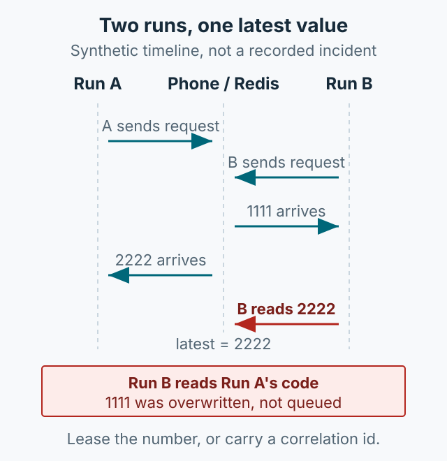

Checking SMS verification codes during test automation is tedious. You may have to find a test phone or ask the person holding it. This article describes the structure of an internal tool built to reduce that work. The original emphasized the convenience of sharing a test SIM: if the phone sits in a drawer, anyone who can install the app can share its number. The source records no approval boundary, sender allowlist, or internal network access control; I would establish them before publishing such a tool today.



*Figure 1. Codes from a test phone travel through an internal server to Slack and an automation API. Redis keeps a short-TTL entry.*

## Problem and scope

When several test scenarios share a test number, it is hard to know who received a code and when. Giving each number an owner creates a different bottleneck: someone has to be available whenever authentication is needed. The goal was to let a small team see the arrival time and code for a short period in one place.

The tool had three parts:

- **Android app**: detects SMS on a test phone and sends it to the internal server.
- **Web server**: registers devices, serves recent codes, and keeps the UI updated in real time.
- **Automation API**: lets test scripts fetch the most recent code.

## Android receiving and permissions

Reading SMS on Android requires the `RECEIVE_SMS` permission. General SMS receipt and the SMS Retriever API behave differently. SMS Retriever only reads messages that contain an app hash, so treat the two paths as separate mechanisms. Apps distributed through Google Play are also subject to its SMS permission policy; check that policy for the actual distribution path.

The original code uses `SmsMessage.createFromPdu((byte[]) pdu)`. The single-argument method was deprecated in API 23; use `createFromPdu(byte[] pdu, String format)` instead. See the [SmsMessage reference](https://developer.android.com/reference/android/telephony/SmsMessage).

```kotlin
// Concept example: extract a four-digit code and forward it
private fun forwardSms(body: String) {
    val code = Regex("\\b\\d{4}\\b").find(body)?.value ?: return
    webSocket.sendSmsData(code)
}
```

The original example compared against a specific sender in code and read the Slack channel from device registration data. If publishing this today, move the sender allowlist and channel IDs into configuration, and limit who can register or remove a device.

## Server and storage policy

The server used FastAPI and Redis and was deployed to internal hardware with Docker. The original says codes stay in Redis for 10 minutes of TTL. The web UI used WebSocket updates, and test scripts read only the most recent value.

```python
# Concept example: keep the code for 10 minutes
await redis.set(f"sms:{phone_number}", code, ex=600)
```

Slack alerts went to a channel registered per device. Alerts included the phone number, code, and receive time. The Android app accepted the device description, manager, and Slack channel, while the web UI displayed those details. WebSocket sessions were capped at 30 minutes and cleaned up on browser refresh or close.

Keeping message bodies and codes out of logs, limiting retention, and adding internal authentication are recommendations for publishing this today. The source does not record that those controls were implemented.

## Connecting automation

A test fetches the recent code when authentication is needed. After pressing “send SMS,” it polls the API for a limited time and enters the value when it appears. Add a timeout and retry limit on the test side so it does not wait forever when no message arrives.

```python
code = wait_for_sms(phone_number, timeout=60)
assert code, "SMS code was not received"
```

The original also describes Jenkins checking for branch changes every five minutes, deploying the web server with Docker, and building the APK. What this tool reduced was the time spent locating a person to read a message. It added the need to manage device registration and Slack channels, and test-number changes require configuration updates.

## Summary

SMS-based automation is convenient, but it becomes risky when permissions and privacy boundaries are vague. The source structure is an Android receiver, a FastAPI/Redis/WebSocket server, Slack alerts, and a recent-code API. Approved devices, sender limits, internal network access control, short retention, and minimal logging are current recommendations to add. The code here is an abbreviated explanation of the structure, not a current implementation; check it against the latest Android version and your organization's policy.
