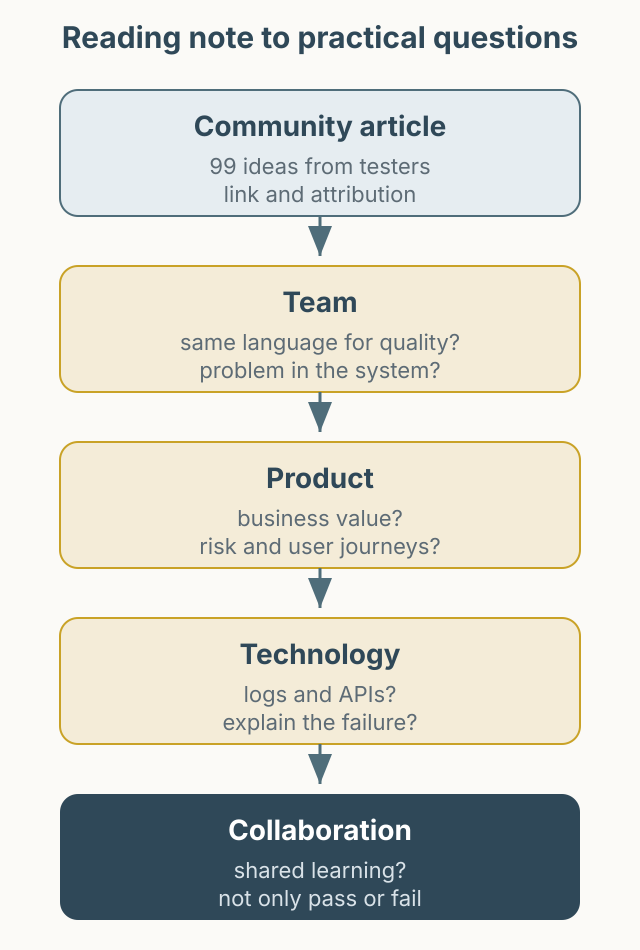

In 2018, the Ministry of Testing community collected ideas on what software testers can do to improve. This is a short reading note written in 2021. At that time, the original thread was still being updated.

- Original: [Community Thoughts: 99 Things You Can Do To Become A Better Software Tester v2.0](https://club.ministryoftesting.com/t/99-things-you-can-do-to-become-a-better-software-tester/17923)

*Figure 1. Instead of republishing the thread, turn it into questions for a team context.*

## How I read it

This is not a translation or a full repost. The original contains short contributions from many testers, and copying them would strip away their context. I converted the ideas into questions to ask about a team rather than summarizing them as my own experience.

## Questions the reading raised

- **Team**: Do developers, product managers, and testers use the same language for quality? When we disagree, do we put the problem in the system rather than on a person?
- **Product**: Can I explain the business value of this feature? Is the test scope connected to user journeys and risk rather than a list of screens?
- **Technology**: Can I verify state through logs and APIs? Can I explain an automation failure when it happens?
- **Collaboration**: Do I share what we learned, not just a pass/fail count?

The thread includes advice such as “don't make developers the enemy,” “learn the business,” and “testing is social.” The sentences are short, but living up to them takes a lot of conversation and observation.

## What stayed with me

The methods were closer to basic habits than to sophisticated tools: ask good questions, keep evidence, and do not hide failures. This note does not replace the original. If the topic interests you, read the thread directly and choose the questions that fit your team.
