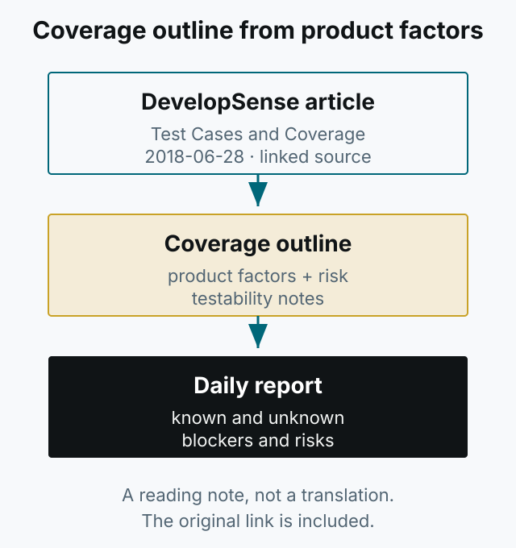

This is a short note from reading Michael Bolton's “Test Cases and Coverage” on DevelopSense (2018-06-28). Original: [Test Cases and Coverage](https://developsense.com/blog/2018/06/test-cases-and-coverage)

*Figure 1. Start from product factors and risk, not from a test case list.*

The original separates test case documents from testing activity and emphasizes a coverage outline driven by product factors and risk. It argues that a daily report should carry testability and risks to product value rather than pass/fail counts.

Read the original for the ideas and their context. This note is not a substitute for the article or a translation of it.
