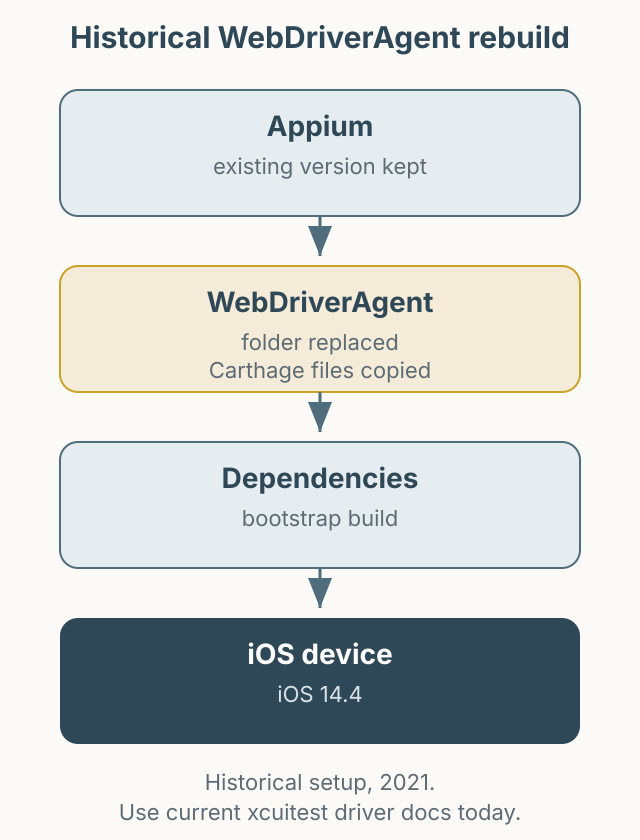

This is a record of updating only WebDriverAgent on iOS 14.4 in 2021 without upgrading the entire Appium installation. The structure of Appium and the XCUITest driver has changed, so if you face a similar issue today, check the [`appium-xcuitest-driver` documentation](https://appium.github.io/appium-xcuitest-driver/) before following these commands.

*Figure 1. Replacing WebDriverAgent and rebuilding its Carthage dependencies at the time.*

## The situation

After updating to iOS 14.4, the existing WebDriverAgent stopped working. The automation project required keeping the Appium version, so only WebDriverAgent had to change. The build failed in the Carthage wrapper.

The workaround was to download files from the `appium/WebDriverAgent` repository and replace the existing `appium-webdriveragent` folder. Because the new folder lacked Carthage files, I preserved `Carthage`, `Scripts/carthage.sh`, `Cartfile`, and `Cartfile.resolved` from the old folder and copied them back, then ran `carthage-wrapper.sh bootstrap`.

## What I would do now

Today the Appium XCUITest driver manages the WebDriverAgent build, and replacing the folder manually is not recommended. A safer sequence is:

1. Check the Appium and `appium-xcuitest-driver` versions in the official documentation.
2. Confirm compatibility with the device iOS version and Xcode.
3. Run diagnostics such as `appium driver doctor xcuitest`.
4. If the issue remains, collect both the driver log and the WebDriverAgent build log.

## Summary

This article preserves a past troubleshooting path. Applying specific old commands to a current environment can make the problem worse. When reading older automation posts, separate “this is what we did then” from “this is what you should do now.”
